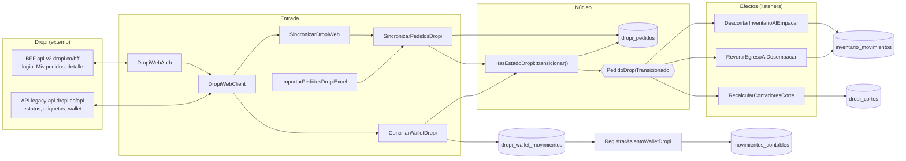
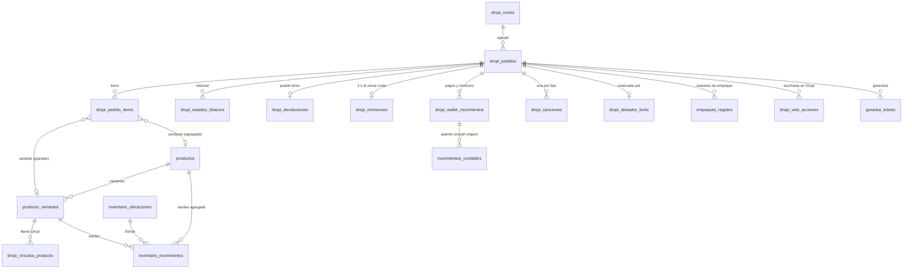
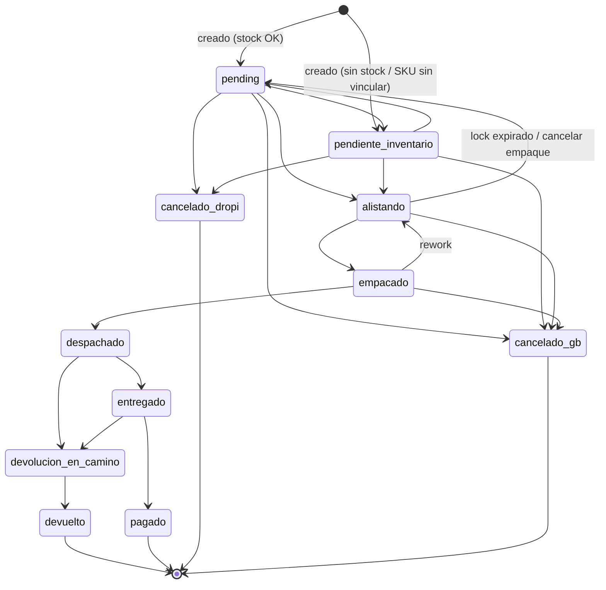
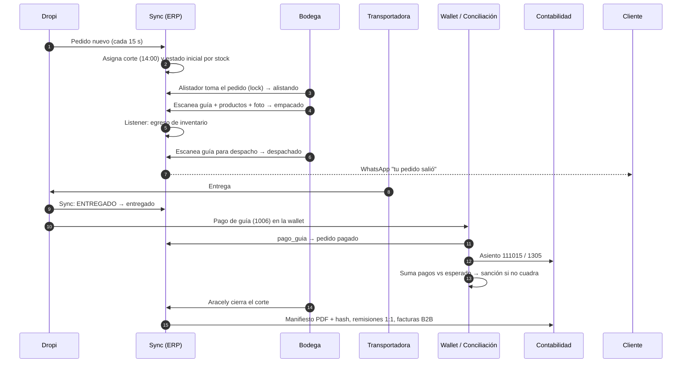
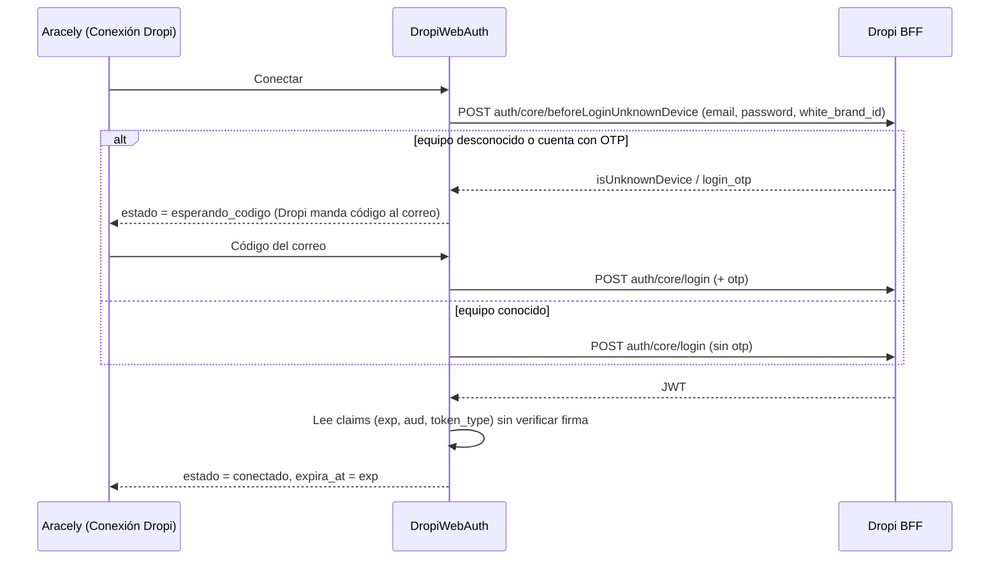
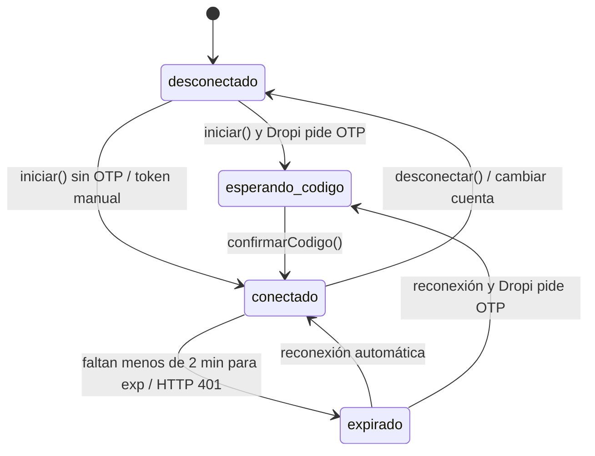
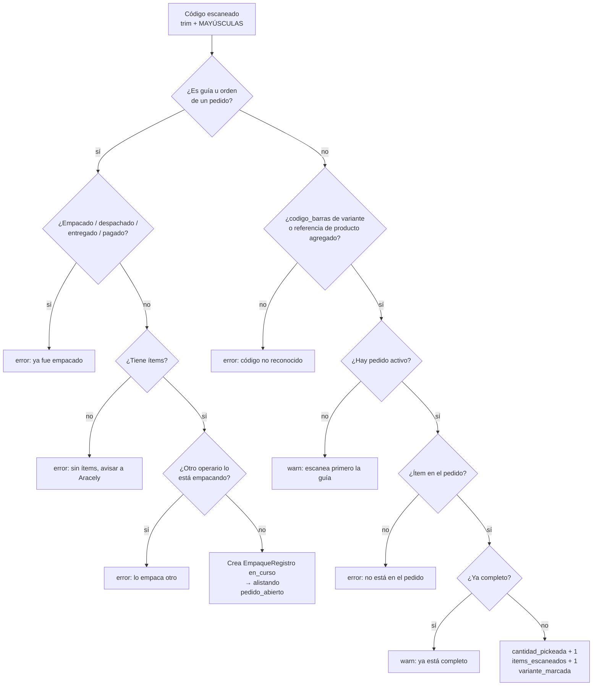

# Módulo Dropi · Documentación técnica

> Referencia completa del módulo `app/Modules/Dropi` del ERP de Great Baby.
> Escrita el 2026-11-09 contra la rama `feat/dropi-web-driver` (último commit `83db20ca`).
> Cada afirmación apunta a su archivo. Si el código cambia, este documento puede quedar viejo: ante la duda, manda el código.

---

## Índice

1. [Qué es y para qué sirve](#1-qué-es-y-para-qué-sirve)
2. [Glosario](#2-glosario)
3. [Arquitectura](#3-arquitectura)
4. [Configuración (.env y config/dropi.php)](#4-configuración-env-y-configdropiphp)
5. [Modelo de datos](#5-modelo-de-datos)
6. [Máquina de estados del pedido](#6-máquina-de-estados-del-pedido)
7. [Eventos, listeners y efectos colaterales](#7-eventos-listeners-y-efectos-colaterales)
8. [Flujo de punta a punta](#8-flujo-de-punta-a-punta)
9. [Entrada de pedidos: sync, driver web e importación Excel](#9-entrada-de-pedidos-sync-driver-web-e-importación-excel)
10. [Driver web: conexión con la cuenta de Dropi](#10-driver-web-conexión-con-la-cuenta-de-dropi)
11. [Escribir en Dropi desde el ERP](#11-escribir-en-dropi-desde-el-erp)
12. [Cortes, manifiesto y remisiones](#12-cortes-manifiesto-y-remisiones)
13. [Alistamiento, empaque y despacho](#13-alistamiento-empaque-y-despacho)
14. [Devoluciones](#14-devoluciones)
15. [Wallet y conciliación](#15-wallet-y-conciliación)
16. [Contabilidad e inventario (kardex)](#16-contabilidad-e-inventario-kardex)
17. [Vincular productos de Dropi con el catálogo](#17-vincular-productos-de-dropi-con-el-catálogo)
18. [Alertas y auditorías](#18-alertas-y-auditorías)
19. [Comandos Artisan y programación (scheduler)](#19-comandos-artisan-y-programación-scheduler)
20. [Interfaz de usuario: pantallas, rutas y permisos](#20-interfaz-de-usuario-pantallas-rutas-y-permisos)
21. [Notificaciones (WhatsApp y broadcast)](#21-notificaciones-whatsapp-y-broadcast)
22. [Pruebas](#22-pruebas)
23. [Operación y diagnóstico (runbook)](#23-operación-y-diagnóstico-runbook)
24. [Reglas de oro para tocar el módulo](#24-reglas-de-oro-para-tocar-el-módulo)
25. [Hallazgos abiertos detectados al documentar](#25-hallazgos-abiertos-detectados-al-documentar)
26. [Mapa de archivos](#26-mapa-de-archivos)

---

## 1. Qué es y para qué sirve

Great Baby es **proveedor** en Dropi (plataforma de dropshipping colombiana). Los vendedores (dropshippers) venden los productos de Great Baby en sus tiendas; Dropi crea el pedido, Great Baby lo **alista, empaca y despacha** desde su bodega, la transportadora lo entrega y Dropi le **paga a Great Baby por su wallet** el precio de proveedor.

El módulo Dropi es la capa del ERP que:

| Necesidad | Cómo la resuelve |
|---|---|
| Saber qué pedidos llegaron y en qué estado están | Sync con Dropi (driver `web`, `api` o `mock`) o importación del Excel de Dropi → tabla `dropi_pedidos` |
| Organizar el trabajo de bodega por tandas | **Cortes** diarios (14:00 y 18:00) con cierre formal, manifiesto PDF firmado por hash |
| Alistar y empacar sin errores | Vista del Alistador (recolección + empaque con bloqueo), Estación de Empaque con pistola, foto obligatoria |
| Despachar y avisar al cliente | Escáner de guías + WhatsApp al cliente final |
| Descontar inventario solo cuando la mercancía sale | Listener al pasar a `Empacado` → egreso en kardex |
| Recibir devoluciones y decidir qué hacer con la mercancía | Registro de devolución con destino (reingreso, avería, baja, nunca llegó) |
| Saber si Dropi pagó lo que debía | Importación de la wallet, conciliación pedido↔pago, sanciones por diferencias |
| Contabilizar todo | Asiento automático por cada movimiento de wallet; asiento y nota crédito por devolución; remisiones 1:1 y facturas B2B al cerrar corte |

Las referencias `§N` que aparecen en los comentarios del código (por ejemplo `§5`, `§15`, `§21`) remiten al **documento de diseño Dropi** original; las etiquetas tipo `Re-audit DR-β`, `F7`, `P3`, `H4` remiten a rondas de auditoría y fixes. No hace falta tener esos documentos para entender este README.

---

## 2. Glosario

| Término | Significado en el ERP |
|---|---|
| **Pedido / guía** | Un `DropiPedido`. La **guía** (número de la transportadora) es su identidad estable: única, guardada en MAYÚSCULAS y sin espacios. |
| **Orden de Dropi** (`dropi_orden_id`) | El ID del pedido dentro de Dropi. También es único. Con el driver web es la llave principal de búsqueda, porque un pedido sin despachar todavía no tiene guía. |
| **Guía provisional** | `SIN-GUIA-<orden>`: la que se le pone a un pedido que Dropi todavía no despachó. Se reemplaza sola cuando Dropi asigna la guía real (`MapearPedidoDropiWeb::PREFIJO_SIN_GUIA`). |
| **Corte** | Tanda de pedidos del día. Corte 1 = creados antes de las 14:00; corte 2 = desde las 14:00. Se **cierra** con snapshot + hash SHA-256 + PDF y queda inmutable. |
| **Alistador** | Operario de bodega que recoge y empaca. Rol `Alistador`. |
| **Aracely** | La administradora (rol de gestión). En el código, `User::esAracely()` es el chequeo de "administrador del negocio". |
| **Lock del alistador** | Reserva de un pedido por un alistador (`dropi_alistador_locks`) con *heartbeat*; se libera sola a los 10 min sin latido. |
| **Empaque / registro de empaque** | `EmpaqueRegistro`: la sesión de empaque de un pedido (inicio, fin, ítems escaneados, foto). |
| **Kardex** | `inventario_movimientos`: libro de movimientos de inventario, *append-only*, cantidades con signo. |
| **Wallet** | Billetera de Great Baby dentro de Dropi. Ahí entran los pagos por guía y salen retiros, fletes, comisiones. |
| **Pago de guía** | Movimiento de wallet que paga un pedido entregado (`pago_guia`, códigos Dropi 1006 y su reverso 1009). |
| **Sanción** | Diferencia detectada entre lo esperado y lo pagado, o pago sobre un pedido devuelto (`dropi_sanciones`). |
| **Huérfano** | Movimiento de wallet sin pedido enlazado (llegó antes que el pedido al ERP). |
| **Mercancía fantasma** | Dropi dice "devuelto" pero el paquete nunca llegó físicamente a bodega. |
| **Remisión** | Documento interno 1:1 por pedido despachado (`REM-DP-000001`), base para facturación ARI/notas crédito. |
| **Producto agregado vs granular** | Un `Producto` con `desglose_stock=false` (agregado) lleva stock a nivel producto y no tiene variantes; uno granular lleva stock por `ProductoVariante`. |
| **Vínculo** | Asociación manual entre la llave de un producto en Dropi (`DV-<variación>`, SKU o `DP-<producto>`) y una variante del catálogo GB. |
| **Huella** | Hash de la fila de lista de un pedido de Dropi (`dropi_web_huellas`) para saber si cambió sin pedir el detalle. |
| **BFF / API legacy** | Los dos backends de Dropi que usa el driver web: `api-v2.dropi.co/bff` (lecturas y login) y `api.dropi.co/api` (escrituras y wallet). |

---

## 3. Arquitectura

### 3.1 Capas

```
app/Modules/Dropi/
├── Clients/        Contrato con Dropi + 3 drivers (mock, api, web)
├── Services/       Auth web, mapeadores (web, Excel, wallet), cruce wallet, WhatsApp
├── DTOs/           PedidoDropiDTO, ItemDropiDTO, PagoWalletDTO (formato interno neutro)
├── Actions/        Casos de uso (lorisleiva/laravel-actions, trait AsAction)
├── Concerns/       HasEstadoDropi: la máquina de estados del pedido
├── Enums/          Estados, categorías, tipos
├── Events/         PedidoDropiTransicionado, PedidoDespachado
├── Listeners/      Efectos colaterales de los cambios de estado y de la wallet
├── Jobs/           NotificarClienteDespachoJob
├── Models/         Eloquent (pedidos, cortes, wallet, kardex, catálogo, sesión web…)
├── Filament/       Panel /admin (páginas, recursos, widgets)
├── Exceptions/     DropiSesionNoDisponible
└── Providers/      DropiServiceProvider (bindings + listeners)
```

Fuera de la carpeta del módulo, pero parte de él:

| Lugar | Qué hay |
|---|---|
| `config/dropi.php` | Toda la configuración |
| `routes/console.php` | Programación de los comandos `dropi:*` |
| `routes/web.php` | Rutas Vue/Inertia `/app/dropi/*`, estación de empaque, escáner, manifiesto, TV |
| `routes/channels.php` | Canales privados de broadcast `dropi` y `dropi.corte.{id}` |
| `app/Console/Commands/` | Los 8 comandos `dropi:*` + `empaque:cerrar-huerfanos` + `gb:purgar-fotos-empaque` |
| `app/Http/Controllers/App/Dropi*Controller.php` | Controladores Vue de Dropi |
| `app/Http/Controllers/App/EstacionEmpaqueController.php` | Estación de empaque (Vue) |
| `app/Http/Controllers/Dropi/` | Escáner de guías, manifiesto, foto de empaque, modo TV, plantilla de productos |
| `resources/js/Pages/Dropi/` | Pantallas Vue |
| `resources/views/dropi/` | Vistas Blade de Filament y el PDF del manifiesto |
| `app/Modules/Cartera/Actions/` | `GenerarFacturasB2BDeCorte`, `ContabilizarDevolucionDropi`, `EmitirNotaCreditoDropi` (disparadas por Dropi) |
| `tests/Feature/Dropi/`, `tests/Unit/Dropi/` | Pruebas |

### 3.2 Los tres drivers

Todo el ERP habla con Dropi a través de **un solo contrato**, `DropiClientInterface` (`app/Modules/Dropi/Clients/DropiClientInterface.php`):

| Método | Devuelve |
|---|---|
| `pedidosDesde(CarbonImmutable $desde)` | `Collection<PedidoDropiDTO>` creados/actualizados desde esa fecha |
| `consultarGuia(string $guia)` | `?PedidoDropiDTO` |
| `walletDesde(CarbonImmutable $desde)` | `Collection<PagoWalletDTO>` del más viejo al más nuevo |
| `driver()` | `'mock' \| 'api' \| 'web'` |

`DropiServiceProvider::register()` resuelve la implementación según `config('dropi.driver')` (`DROPI_DRIVER`):

| Driver | Clase | Estado | Uso |
|---|---|---|---|
| `mock` (default) | `DropiMockClient` | Funcional | Lee `storage/app/dropi-fixtures/pedidos.json` y `wallet.json`. Desarrollo y CI. Si no existen los archivos devuelve vacío. |
| `api` | `DropiApiClient` | **Sin implementar** | Esperando la API oficial de Dropi (§26). Si faltan `DROPI_API_URL`/`DROPI_API_KEY` lanza `RuntimeException`; si están, lanza `LogicException('aún no implementado')`. |
| `web` | `DropiWebClient` | Funcional (producción) | Usa la API interna de `app.dropi.co` con la sesión de una cuenta real. Es el puente mientras no exista API oficial. |

> **Importante:** el sync casi en tiempo real (`SincronizarDropiWeb`) y la wallet (`dropi:web-wallet-sync`) usan `DropiWebClient` **directamente**, no por el interface. Funcionan aunque `DROPI_DRIVER` no sea `web`; lo que los enciende es `DROPI_WEB_SYNC=true` (ver §19). El driver del interface solo afecta a `dropi:sync`, a `ConciliarWalletDropi` cuando se llama desde Filament y a `dropi:reconciliar-huerfanos`.

### 3.3 Diagrama de componentes



---

## 4. Configuración (.env y config/dropi.php)

### 4.1 Variables de entorno

| Variable | Default | Para qué |
|---|---|---|
| `DROPI_DRIVER` | `mock` | Driver del interface: `mock`, `api` o `web`. |
| `DROPI_API_URL` | `''` | Base URL de la API oficial (driver `api`, aún no implementado). |
| `DROPI_API_KEY` | `''` | Token Bearer de la API oficial. |
| `DROPI_API_TIMEOUT` | `15` | Timeout HTTP en segundos (driver `api`). |
| `DROPI_WEB_EMAIL` | `''` | Cuenta de Dropi para el driver web **si no hay una configurada desde el CRM** (ver §10.4). |
| `DROPI_WEB_PASSWORD` | `''` | Clave de esa cuenta. |
| `DROPI_WEB_BRAND_ID` | `1` | `white_brand_id` que exige el login de Dropi. |
| `DROPI_WEB_BFF_URL` | `https://api-v2.dropi.co/bff` | Backend de lectura y login. |
| `DROPI_WEB_LEGACY_URL` | `https://api.dropi.co/api` | Backend de escritura y wallet. |
| `DROPI_WEB_TIMEOUT` | `20` | Timeout HTTP del driver web. |
| `DROPI_WEB_SYNC` | `false` | **Interruptor** del sync programado de pedidos y wallet. |
| `DROPI_WALLET_DESDE` | `2026-09-01` | Primer día que se importa de la wallet. No se trae historia anterior porque cada movimiento genera asiento contable (decisión de Samuel). |
| `WHATSAPP_DRIVER` | `mock` | `mock` solo escribe al log; `cloud` envía por WhatsApp Cloud API. |
| `WHATSAPP_TOKEN` | `''` | Token de Meta. |
| `WHATSAPP_PHONE_ID` | `''` | Phone ID de Meta. |
| `WHATSAPP_TEMPLATE_DESPACHO` | `pedido_despachado_v1` | Plantilla aprobada para el aviso de despacho. |

`.env.example` solo trae `DROPI_WEB_EMAIL`, `DROPI_WEB_PASSWORD`, `DROPI_WEB_SYNC` y las de WhatsApp; el resto toma su default.

### 4.2 Bloques de `config/dropi.php` que no salen del .env

```php
'mock' => ['fixtures_path' => storage_path('app/dropi-fixtures')],

'cortes' => [            // ventanas horarias (documentales: AsignarCorteACarga
    1 => ['cierra_a' => '14:00'],   // tiene el corte a las 14:00 fijo en código)
    2 => ['cierra_a' => '18:00'],
],

'alertas' => [
    'plazo_dropi_horas'              => 72, // Dropi sanciona a 72 h sin despachar
    'aviso_previo_horas'             => 48, // aviso a las 48 h
    'devolucion_no_confirmada_dias'  => 7,
    'entrega_pendiente_dias'         => 7,
    'entrega_critica_dias'           => 10,
    'entrega_contactar_dias'         => 15,
    'retiro_wallet_normal_dias'      => 15,
    'retiro_wallet_aviso_dias'       => 20,
],
```

> Ojo: `AsignarCorteACarga` usa `hour < 14` en código; **no lee** `config('dropi.cortes')`. Cambiar el config no mueve la hora de corte (ver §25).

### 4.3 Parámetros que viven en "Reglas"/settings (base de datos)

Se leen con `setting()` o `\App\Support\Reglas::get()` y se pueden cambiar sin desplegar:

| Clave | Default | Dónde se usa |
|---|---|---|
| `dropi.dias_retorno_mercancia` | 20 | `AuditarMercanciaEnTransito` |
| `dropi.dias_tolerancia_devolucion` | 7 | `AuditarMercanciaFantasma` |
| `dropi.dias_espera_cobro` | 40 | Discrepancias (Vue), `DropiOperacionController::discrepancias` |
| `empaque.foto_obligatoria` | `true` | `EstacionEmpaqueController::confirmar` |
| `empaque.max_foto_bytes` | 3 000 000 | `EstacionEmpaqueController::guardarFoto` |
| `empaque.min_foto_bytes` | 30 000 | ídem (rechaza fotos "vacías") |
| `empaque.retention_foto_dias` | 180 | `gb:purgar-fotos-empaque` (Habeas Data) |

### 4.4 Puesta en marcha rápida

**Desarrollo (sin tocar Dropi):**

```bash
# .env
DROPI_DRIVER=mock
DROPI_WEB_SYNC=false
WHATSAPP_DRIVER=mock
```

Poner fixtures en `storage/app/dropi-fixtures/pedidos.json` y `wallet.json` (formato en §9.5) y correr `php artisan dropi:sync --horas=720`.

**Producción con el driver web:**

1. `DROPI_DRIVER=web` y `DROPI_WEB_SYNC=true` en el `.env`.
2. Configurar la cuenta: en `.env` (`DROPI_WEB_EMAIL`/`DROPI_WEB_PASSWORD`) o, mejor, desde **/admin → Dropi → Conexión Dropi → Cuenta de Dropi** (queda cifrada en BD).
3. En la misma pantalla, **Conectar** y escribir el código que Dropi manda al correo.
4. Asegurar que el scheduler corre (`php artisan schedule:work` o el cron de `schedule:run` cada minuto). El sync de 15 s necesita que el scheduler esté vivo de forma continua.
5. Vigilar `storage/logs/laravel.log` por `dropi.web.*`.

---

## 5. Modelo de datos

### 5.1 Diagrama entidad-relación



### 5.2 Tablas

#### `dropi_pedidos` — modelo `DropiPedido`
Corazón del módulo. `SoftDeletes`, `Auditable` (owen-it), trait `HasEstadoDropi`.

| Columna | Tipo | Notas |
|---|---|---|
| `id` | bigint | |
| `corte_id` | FK `dropi_cortes` | **NOT NULL**, `restrict`. Se asigna al crear y no se reasigna en el sync. |
| `guia` | varchar(40) | **UNIQUE**. MAYÚSCULAS. Puede ser `SIN-GUIA-<orden>`. |
| `dropi_orden_id` | varchar(60) null | **UNIQUE** (`uniq_dropi_orden_id`). |
| `transportadora`, `tienda`, `tienda_id` | varchar | |
| `vendedor_nombre`, `vendedor_identificacion` | varchar | Dropi no manda la identificación; se escribe en el ERP. |
| `requiere_factura_b2b` | bool | Si el vendedor pide factura B2B (se factura al cerrar el corte). |
| `cliente_nombre` | varchar(120) | Default `'SIN NOMBRE'`. |
| `cliente_doc`, `cliente_telefono`, `cliente_direccion`, `cliente_ciudad`, `cliente_depto` | varchar | PII del comprador final. |
| `estado` | varchar(30) | Enum `EstadoPedidoDropi`. Default `pending`. **`$guarded`**: solo se cambia con `transicionar()`. |
| `despachado_at`, `entregado_at`, `devuelto_at`, `pagado_at` | timestamp | Fechas de hito. El sync solo las pisa si la nueva es más reciente. |
| `ignorar_alerta_transito` | bool | Excluye el pedido de la alerta de mercancía en tránsito. |
| `notificado_despacho_at` | timestamp | Idempotencia del WhatsApp de despacho. |
| `monto_esperado_proveedor` | decimal(12,2) | Lo que Dropi le debe pagar a GB (suma de precio proveedor × cantidad). |
| `monto_cliente_final`, `ganancia_vendedor`, `flete_transportadora` | decimal | Informativos (vienen de Dropi). |
| `remision_interna_id`, `ari_factura_id`, `ari_enviado_at`, `nota_credito_id` | | Trazabilidad fiscal. |

Relaciones: `corte`, `items`, `bitacoraEstados`, `devolucion` (hasOne), `remision` (hasOne), `pagoWallet` (hasOne, `tipo=pago_guia`), `sanciones`.

Índices relevantes: `(corte_id, estado)`, `(estado, despachado_at, ignorar_alerta_transito)` para la alerta de tránsito, `(estado, devuelto_at)` para mercancía fantasma.

#### `dropi_pedido_items` — `DropiPedidoItem`
`SoftDeletes`, `Auditable`, `$guarded` (cantidad y precio no se asignan en masa desde formularios).

| Columna | Notas |
|---|---|
| `pedido_id` | FK, `cascade` al borrar el pedido. |
| `variante_id` | null si el producto de Dropi no está vinculado o si es un producto agregado. |
| `producto_id` | Se autollena desde la variante al crear (`booted::creating`). |
| `sku_dropi` | Llave del producto en Dropi: `DV-<variation_id>`, el SKU, o `DP-<product_id>`. Índice. |
| `producto_nombre`, `variacion` | Texto de Dropi. |
| `cantidad` | unsigned int. |
| `precio_proveedor_unit` | decimal. |
| `cantidad_pickeada`, `pickeado_at`, `pickeado_por` | Progreso del escaneo en la estación de empaque. |
| `ubicacion_asignada_id`, `despachado` | Campos de operación. |

Identidad de un ítem en el upsert del sync: `(pedido_id, sku_dropi)`.

#### `dropi_cortes` — `DropiCorte`
`SoftDeletes` (retención DIAN 5 años), `Auditable`. `$guarded` protege `estado`, `cerrado_por`, `cerrado_at`, `manifiesto_hash`: solo `CerrarCorte` los escribe.

| Columna | Notas |
|---|---|
| `fecha` + `numero` | **UNIQUE** juntos. |
| `estado` | `abierto` / `cerrado` (`EstadoCorte`). |
| `pedidos_totales`, `pedidos_pendientes_inv`, `pedidos_despachados`, `pedidos_pagados` | Contadores. Los mantiene `RecalcularContadoresCorte` mientras el corte está abierto. |
| `cerrado_por`, `cerrado_at` | |
| `manifiesto_hash` | SHA-256 del snapshot, **UNIQUE**. |
| `manifiesto_pdf_path` | `manifiestos/corte-<id>-<hash>.pdf` en `storage/app`. |
| `snapshot_json` | Totales y guías congelados al cierre. |

#### `dropi_estados_bitacora` — `DropiEstadoBitacora`
Una fila por cada cambio de estado (y por cada creación de pedido). Sin `updated_at`.

`pedido_id`, `estado_desde` (null en la creación), `estado_hasta`, `fuente` (`manual` / `sistema` / `api`), `payload` (JSON con el origen: `sync`, `estacion_empaque`, `lock_expirado`, `conciliacion`…), `user_id`, `created_at`.

#### `dropi_devoluciones` — `DropiDevolucion`
Una por pedido (lo garantiza `RegistrarDevolucion`). `SoftDeletes`, `Auditable`.

`pedido_id`, `recibido_at`, `destino_inventario` (`DestinoDevolucion`), `decision_por`, `genero_nota_credito`, `nota_credito_ari_id`, `notas`.

Al crearse dispara (vía `SafeAction`) `Cartera\ContabilizarDevolucionDropi` y `Cartera\EmitirNotaCreditoDropi` (ver §14).

#### `dropi_wallet_movimientos` — `DropiWalletMovimiento`
`SoftDeletes`, `Auditable`, `$guarded`.

| Columna | Notas |
|---|---|
| `dropi_movimiento_id` | **UNIQUE**. `web:<id Dropi>` (driver web), `MOCK-…` (mock), `synth:<sha256>` (sin id), `synth:manual:<sha256>` (ajuste manual). Idempotencia. |
| `fecha` | Fecha local (Dropi manda UTC; se convierte). |
| `tipo` | `TipoMovimientoWallet`. |
| `monto` | Con signo: entradas positivas, salidas negativas. |
| `pedido_id` | null = huérfano. |
| `categoria` | varchar(40): código Dropi + inicio de la descripción, o categoría manual. |
| `fuente` | JSON crudo de Dropi, o `{origen: ajuste_manual, user_id}`. |

Al crearse, y al cambiar `monto/tipo/fecha/pedido_id/dropi_movimiento_id/categoria`, genera su asiento contable (§16.1).

#### `dropi_sanciones` — `DropiSancion`
**UNIQUE `(pedido_id, tipo)`**: como mucho una sanción de cada tipo por pedido. `tipo` es `TipoSancion`. `monto_esperado`, `monto_recibido`, `diferencia` (firmada: + subpago, − sobrepago), `detectada_at`.

#### `dropi_remisiones` — `DropiRemision`
`pedido_id`, `consecutivo` (**UNIQUE**, `REM-DP-000001`), `valor_proveedor`, y los campos de ARI/DIAN `ari_lote_id`, `ari_factura_id`, `enviada_ari_at`, `cufe`, `estado_dian`.

#### `dropi_alistador_locks` — `DropiAlistadorLock`
`pedido_id` (**UNIQUE**, un dueño por pedido), `alistador_id`, `locked_at`, `heartbeat_at`.

#### `empaques_registro` — `EmpaqueRegistro`
`pedido_id`, `operario_id`, `inicio_at`, `fin_at`, `items_totales`, `items_escaneados`, `duracion_segundos`, `estado` (`EstadoEmpaque`: `en_curso` / `completado` / `anulado`), `notas`, `foto_path`, `foto_at`, `foto_purga_intentos`, `foto_purga_ultimo_fallo_at`.
Columna virtual `pedido_activo` con **UNIQUE**: impide dos registros `en_curso` para el mismo pedido a nivel de base de datos.

#### `dropi_sync_estado`
`recurso` (**UNIQUE**) + `last_sync_at`. Lo usa `SincronizarPedidosDropi::handle()` como marca de agua (`recurso='pedidos'`), escrita con `GREATEST()` para que dos syncs concurrentes no la hagan retroceder.

#### Tablas del driver web

| Tabla | Modelo | Para qué |
|---|---|---|
| `dropi_web_sesion` | `DropiWebSesion` | Una fila por email. `token` (cifrado, oculto), `expira_at`, `estado` (`desconectado` / `esperando_codigo` / `conectado` / `expirado`), `ultimo_error`, `conectado_por`, `conectado_at`, `ultimo_uso_at`. |
| `dropi_web_cuenta` | `DropiWebCuenta` | Cuenta configurada desde el CRM. `password` cifrado y excluido de la auditoría. Si existe, manda sobre el `.env`. |
| `dropi_web_huellas` | (query builder) | PK `dropi_orden_id`. `huella` (sha1), `estatus_dropi`, `etiquetas` (JSON de ids), `visto_at`, `sincronizado_at`. |
| `dropi_web_acciones` | (query builder) | Auditoría de cada escritura en Dropi: `accion` (`actualizar_estatus`, `poner_etiqueta`, `quitar_etiqueta`, `crear_etiqueta`), `estatus_antes`, `estatus_pedido`, `motivo`, `exito`, `respuesta`, `user_id`. Se escribe **también si falla**. |

#### Catálogo e inventario (compartidos con el resto del ERP)
Los modelos viven en `app/Modules/Dropi/Models` por historia, pero los usa todo el ERP:

| Tabla | Modelo | Notas clave |
|---|---|---|
| `productos` | `Producto` | `desglose_stock` (granular/agregado), `stock_directo`, cuentas contables, campos SIIGO. Observer: si se crea un producto agregado con `stock_directo > 0`, escribe el kardex inicial (se apaga con `Producto::sinKardexAutomatico()`). |
| `producto_variantes` | `ProductoVariante` | `codigo_barras` (se autogenera: `REF-COLORDISEÑO-TALLA`). No se pueden crear variantes de un producto agregado (`DomainException`). |
| `inventario_ubicaciones` | `InventarioUbicacion` | Jerarquía bodega → posición (pasillo/estante/nivel). `categoria` (`CategoriaUbicacion`) decide `disponible_para_venta` al guardar. |
| `inventario_movimientos` | `InventarioMovimiento` | Kardex **append-only** (`updating` lanza `DomainException`). `cantidad` con signo. Auto-llena `producto_id` desde la variante. |
| `dropi_vinculos_producto` | `DropiVinculoProducto` | `sku_dropi` (**UNIQUE**) → `variante_id`. |
| `garantia_tickets` | `GarantiaTicket` | Garantías ligadas a un pedido Dropi. |
| `dropi_pendientes_vincular` | — | Existe en BD pero ningún código la usa: la pantalla de productos sin vincular calcula la lista desde `dropi_pedido_items` (ver §25). |

### 5.3 Enums

| Enum | Valores |
|---|---|
| `EstadoPedidoDropi` | `pending` (Nuevo), `pendiente_inventario`, `alistando`, `empacado`, `despachado`, `entregado`, `devolucion_en_camino`, `devuelto`, `pagado`, `cancelado_dropi`, `cancelado_gb` |
| `EstadoCorte` | `abierto`, `cerrado` |
| `EstadoEmpaque` | `en_curso`, `completado`, `anulado` |
| `CategoriaUbicacion` | `venta` ✅, `reserva_proveedor` ✅, `averia_reparar`, `averia_baja`, `garantia` (✅ = disponible para venta) |
| `DestinoDevolucion` | `reingreso` → venta, `averia_reparar` → avería por reparar, `averia_baja` → avería baja, `baja_total` (sin kardex), `no_llego_fisicamente` (sin kardex) |
| `TipoMovimientoWallet` | `pago_guia`, `retiro_banco`, `indemnizacion`, `flete_garantia`, `tarjeta`, `otro` |
| `TipoSancion` | `diferencia_precio`, `sobrepago`, `categoria_explicita`, `pago_sobre_devuelto`, `mercancia_fantasma`, `mercancia_en_transito` |

### 5.4 DTOs

Todo lo que entra de Dropi se normaliza a estos objetos antes de tocar la base:

- **`PedidoDropiDTO`**: guía, orden, transportadora, tienda, vendedor, cliente (nombre, doc, teléfono, dirección, ciudad, depto), `estadoDropi` (texto **canónico**, ver §9.3), montos, `items[]`, `creadoAt` y fechas de hito, `raw`.
- **`ItemDropiDTO`**: `skuDropi`, `cantidad`, `precioProveedorUnit`, `productoNombre`, `variacion`.
- **`PagoWalletDTO`**: `tipo`, `monto` (con signo), `fecha`, `guia`, `categoria`, `raw`, `dropiMovimientoId`, `ordenId`.

---

## 6. Máquina de estados del pedido

### 6.1 Regla única

**Todo cambio de estado pasa por `DropiPedido::transicionar()`** (trait `app/Modules/Dropi/Concerns/HasEstadoDropi.php`):

```php
$pedido->transicionar(
    EstadoPedidoDropi $nuevo,
    string $fuente = 'manual',     // manual | sistema | api
    ?int $userId = null,
    array $payload = [],           // se guarda en la bitácora
    array $extraFields = [],       // p. ej. ['despachado_at' => now()]
);
```

Qué hace, en una transacción:

1. Bloquea la fila del pedido (`lockForUpdate`).
2. Si el estado ya es el pedido, **no hace nada** (idempotente, sin bitácora ni evento).
3. Si el corte del pedido está **cerrado**: fuente `manual` → `RuntimeException`; otra fuente → solo si `$nuevo->permitidoEnCorteCerrado()`.
4. Valida `EstadoPedidoDropi::puedeIrA($nuevo, $fuente)`; si no, `RuntimeException('transición inválida …')`.
5. Asigna estado y `extraFields`, guarda.
6. Escribe `DropiEstadoBitacora`.
7. Dispara `PedidoDropiTransicionado` → listeners (§7).

`estado` está en `$guarded` en `DropiPedido`: un `$pedido->update(['estado' => …])` **no cambia el estado** y no escribe bitácora (y el código que lo intenta igual queda mintiendo si escribe su propia bitácora; ver §25).

### 6.2 Fuentes

| Fuente | Quién | Reglas |
|---|---|---|
| `manual` | Una persona desde la UI (alistador, Aracely) | Solo las transiciones de la tabla 6.3. Nunca en corte cerrado. |
| `sistema` | Procesos internos: conciliación de wallet, registro de devolución, liberación de locks, vínculo de productos | **Cualquier** transición. En corte cerrado, solo hacia estados permitidos. |
| `api` | El sync con Dropi | **Cualquier** transición (Dropi puede saltar estados legítimamente). En corte cerrado, ídem. |

### 6.3 Transiciones manuales permitidas



- **Terminales** (`esTerminal()`): `pagado`, `cancelado_dropi`, `cancelado_gb`. `devuelto` tampoco tiene salida manual.
- **Permitidos en corte cerrado** (`permitidoEnCorteCerrado()`, solo `sistema`/`api`): `despachado`, `entregado`, `pagado`, `devolucion_en_camino`, `devuelto`, `cancelado_dropi`.
- `RegistrarDevolucion` pasa **cualquier** estado a `devuelto` porque usa fuente `sistema`.

### 6.4 Quién mueve cada transición en la práctica

| Transición | Disparador | Fuente |
|---|---|---|
| (nuevo) → `pending` / `pendiente_inventario` | Sync/Excel crea el pedido: `ResolverEstadoInicial::porSku()` revisa vínculo y stock vendible | `api` (bitácora directa, sin evento) |
| `pendiente_inventario` → `pending` | `VincularProductoDropi` al enlazar el producto si ya hay stock | `sistema` |
| `pending` → `alistando` | Alistador toma el pedido (Vista del Alistador) o escanea la guía en la Estación de Empaque | `manual` |
| `alistando` → `empacado` | `ConfirmarEmpaqueYSiguiente` (exige todo escaneado) o `VistaAlistador::empacarPedido` (Filament) | `manual` |
| `alistando` → `pending` | `dropi:liberar-locks` (heartbeat > 10 min) | `sistema` |
| `empacado` → `despachado` | Escáner de guías / "Despachar" en la vista del alistador | `manual` |
| `despachado` → `entregado`, `devolucion_en_camino`, `cancelado_dropi`… | Sync con Dropi | `api` |
| `entregado` → `pagado` | Conciliación de wallet al llegar el pago de la guía | `sistema` |
| cualquiera → `devuelto` | `RegistrarDevolucion` | `sistema` |
| cualquiera → cualquiera | Edición manual del pedido (Vue `pedidoActualizar`) | `manual` (respeta la tabla) |

---

## 7. Eventos, listeners y efectos colaterales

### 7.1 `PedidoDropiTransicionado`
`app/Modules/Dropi/Events/PedidoDropiTransicionado.php`. Propiedades: `pedido`, `estadoDesde`, `estadoHasta`, `fuente`, `userId`, `payload`. Se dispara **dentro** de la transacción de `transicionar()`: si un listener falla, se revierte el cambio de estado completo.

Registrados en `DropiServiceProvider::boot()` (síncronos):

| Listener | Cuándo actúa | Qué hace |
|---|---|---|
| `DescontarInventarioAlEmpacar` | `estadoHasta = empacado` | Escribe un **egreso negativo** por ítem en la primera ubicación activa de categoría `venta` (`referencia_tipo='dropi_pedido_egreso'`). Idempotente: si ya hay más egresos que reversos para el pedido, no repite. Bloquea las filas del kardex del sujeto antes de escribir. Si no hay ubicación de venta activa, solo deja `Log::warning` y **no descuenta**. |
| `RevertirEgresoAlDesempacar` | `empacado → alistando` | Escribe el **ingreso** compensatorio (`dropi_pedido_egreso_reverso`). Balancea por conteo, así que soporta varios reworks. |
| `RecalcularContadoresCorte` | Siempre | Recalcula los 4 contadores del corte con un `SELECT` agregado. Si el corte está cerrado, **no toca nada** (manda el snapshot firmado). |

Los ítems se tratan de forma **polimórfica**: si el ítem tiene `variante_id`, el movimiento es por variante; si solo tiene `producto_id` (producto agregado), por producto. Ítems sin ninguno de los dos se saltan.

### 7.2 Otros efectos que no cuelgan del evento

| Disparador | Efecto | Archivo |
|---|---|---|
| `DropiWalletMovimiento` creado/actualizado (observer en el modelo) | `RegistrarAsientoWalletDropi::handle()` → asiento de partida doble | `Models/DropiWalletMovimiento.php` |
| `DropiDevolucion` creada (observer) | `Cartera\ContabilizarDevolucionDropi` + `Cartera\EmitirNotaCreditoDropi` vía `SafeAction` | `Models/DropiDevolucion.php` |
| Despacho (escáner/alistador) | `PedidoDespachado` (broadcast) + `NotificarClienteDespachoJob` (cola) | Controladores, no listener |
| `CerrarCorte` | `GenerarRemisionesCorte` + `Cartera\GenerarFacturasB2BDeCorte` | `Actions/CerrarCorte.php` |

> `RegistrarAsientoWalletDropi` está en la carpeta `Listeners/` pero **no** escucha un evento: lo llama el observer del modelo.

---

## 8. Flujo de punta a punta



Variantes:
- **Sin stock o producto sin vincular** → el pedido nace en `pendiente_inventario`; se libera al vincular el producto (§17) o se mueve a mano.
- **Devolución** → Dropi marca `DEVOLUCION` (sync → `devolucion_en_camino`, `devuelto_at`); al llegar el paquete, bodega registra la devolución (§14) → `devuelto` + reingreso/avería + asiento + nota crédito.
- **Alistador abandona** → a los 10 min sin heartbeat el pedido vuelve a `pending` y el empaque queda `anulado`.

---

## 9. Entrada de pedidos: sync, driver web e importación Excel

Hay tres caminos de entrada y **todos terminan en `SincronizarPedidosDropi::guardarPedido()`**, que es la única lógica de upsert.

### 9.1 `SincronizarPedidosDropi` (núcleo de upsert)

`app/Modules/Dropi/Actions/SincronizarPedidosDropi.php`

Dos puntos de entrada:

| Método | Usado por | Marca de agua |
|---|---|---|
| `handle(?CarbonImmutable $desde)` | `dropi:sync` | Sí. Si no se pasa `$desde`, usa `dropi_sync_estado.last_sync_at − 30 min` (o hace 24 h). Procesa en lotes de 200 y libera memoria entre lotes. Al final escribe la marca con `GREATEST()`. |
| `importarPedidos(iterable $dtos)` | Driver web, Excel, resync tras acción | No toca la marca. Al final recalcula en bloque los contadores de **todos los cortes abiertos** (porque los pedidos nuevos se crean sin pasar por `transicionar()`). |

Cada DTO va en su propia transacción: **un pedido tóxico no tumba la corrida** (se cuenta como error y se loguea `dropi.sync.pedido_error` / `dropi.import.pedido_error`).

`guardarPedido()` paso a paso:

1. **Normaliza la guía** (`trim` + `strtoupper`). Guía vacía → `rechazado`.
2. **Sanea**: monto esperado negativo, o un ítem con cantidad ≤ 0 o precio negativo → `rechazado` (el pedido entero).
3. `cliente_nombre` vacío → `'SIN NOMBRE'`.
4. **Corte**: `AsignarCorteACarga::run($dto->creadoAt)` (§12.1).
5. **Busca el existente**: primero por `dropi_orden_id`, después por `guia`.
6. **Guía nueva**: si el existente tiene otra guía, la entrante no es provisional (`SIN-GUIA-`) y no la usa otro pedido (ni borrado), se reemplaza.
7. **Estado objetivo**: `mapearEstadoDropi($dto->estadoDropi)`, con dos protecciones:
   - Un `pending` de Dropi **no hace retroceder** un pedido existente (la bodega ya lo movió).
   - Si el pedido ya está `pagado` (lo puso la wallet) y Dropi dice `entregado`/`despachado`, se ignora (Dropi no tiene estado "pagado").
   - Pedido nuevo sin estado interpretable → `ResolverEstadoInicial::porSku()`.
8. **Existente**: actualiza los campos que **no** son estado ni `corte_id`, **sin pisar con null** (Dropi no manda documento del cliente ni identificación del vendedor). Fechas de hito: solo si la nueva es más reciente. Si el estado cambia → `transicionar($estado, 'api', null, ['origen' => 'sync', 'raw_estado_dropi' => …])`; si la máquina lo bloquea, se loguea `dropi.sync.transicion_bloqueada` y **no** cuenta como cambio. Sincroniza ítems. Devuelve `actualizado` o `sin_cambios`.
9. **Nuevo**: crea el pedido, asigna estado por propiedad, crea ítems y escribe la bitácora inicial (`estado_desde = null`, `fuente = api`, `payload = raw`). **No dispara el evento** (no hay transición). Devuelve `nuevo`.

**Ítems** (`sincronizarItems`): `updateOrCreate` por `(pedido_id, sku_dropi)`, resolviendo `variante_id` con `ResolverEstadoInicial::varianteIdPara()` (vínculo manual primero, luego `codigo_barras`). No pisa con null. **No borra** ítems que Dropi ya no manda.

### 9.2 `ResolverEstadoInicial`

- `varianteIdPara($sku)`: `dropi_vinculos_producto.sku_dropi` → `variante_id`; si no, `producto_variantes.codigo_barras = $sku`.
- `porSku($items)`: para cada ítem, si no hay variante → `pendiente_inventario`; si el stock disponible para venta es menor que la cantidad → `pendiente_inventario`; si todo alcanza → `pending`.
- **Stock disponible** = `SUM(inventario_movimientos.cantidad)` de la variante en ubicaciones `disponible_para_venta = true` y `activa = true`. Nunca cuenta avería ni garantía.

> Limitación: `porSku()` solo mira variantes. Un ítem de **producto agregado** (sin variante) cae siempre en `pendiente_inventario` (ver §25).

### 9.3 Traducción de estados de Dropi

Los estados llegan de Dropi como texto libre y se traducen en **dos pasos**:

**Paso 1 · mapeador de la fuente → texto canónico**

Driver web (`MapearPedidoDropiWeb::estadoCanonico()`):

| Estatus Dropi | Canónico |
|---|---|
| `ENTREGADO` | `entregado` |
| `DEVOLUCION`, `EN REEXPEDICION` | `devolucion` |
| `CANCELADO`, `RECHAZADO`, `REEMPLAZADA` | `cancelado` |
| Previos al despacho: `PENDIENTE`, `PENDIENTE CONFIRMACION`, `PENDIENTE DE CONFIRMACION`, `PENDIENTE REABIERTO`, `CONFIRMADO (PASARÁ A PENDIENTE)`, `EN PROCESAMIENTO`, `TELEMERCADEO`, `GUIA_GENERADA`, `ERROR_GENERANDO_GUIA`, `GUIA_ANULADA`, `PENDIENTE RECOLECCION`, `FALLO RECOLECCION`, `RECOLECCION ANULADA` | `null` (el ERP decide / conserva) |
| Sin efecto: `INDEMNIZADO`, `INDEMNIZADA`, `INDEMNIZADA POR DROPI`, `EN PROCESO DE INDEMNIZACION`, `SINIESTRADO` | `null` |
| **Cualquier otro** (estados de transportadora: `DESPACHADA`, `EN TRANSITO`, `EN REPARTO`, `NOVEDAD`…) | `despachado` |

Política: **Dropi no puede pisar el trabajo de bodega**. Los estados previos al despacho no mueven nada.

Excel (`MapearOrdenesDropiExcel` y `MapearProductosDropiExcel`): `ENTREGADO→entregado`, `CANCELADO/RECHAZADO→cancelado`, `DEVOLUCION/EN REEXPEDICION→devolucion`, `PENDIENTE/EN PROCESAMIENTO/TELEMERCADEO→pendiente`, **cualquier otro → `despachado`**.

**Paso 2 · canónico → enum** (`SincronizarPedidosDropi::mapearEstadoDropi()`, insensible a mayúsculas):

| Texto | Enum |
|---|---|
| `pending`, `nuevo`, `pendiente` | `Pending` |
| `preparando`, `alistando`, `in_preparation` | `Alistando` |
| `empacado`, `packed` | `Empacado` |
| `despachado`, `shipped`, `in_transit`, `en_transito` | `Despachado` |
| `entregado`, `delivered`, `completed` | `Entregado` |
| `devolucion`, `devolucion_en_camino`, `return_in_transit` | `DevolucionEnCamino` |
| `devuelto`, `returned` | `Devuelto` |
| `pagado`, `paid`, `settled` | `Pagado` |
| `cancelado`, `canceled`, `cancelled`, `cancelado_dropi` | `CanceladoDropi` |
| `cancelado_gb`, `canceled_by_seller` | `CanceladoGb` |
| otro / vacío | `null` |

### 9.4 Driver web: `SincronizarDropiWeb` (casi tiempo real)

`app/Modules/Dropi/Actions/SincronizarDropiWeb.php`. Dropi no tiene webhooks para proveedores, así que se le pregunta en **tres ritmos**:

| Modo | Frecuencia | Qué consulta | Para qué |
|---|---|---|---|
| `recientes` | cada 15 s | 1 página de 50 de "Mis pedidos", del más nuevo al más viejo | Pedidos nuevos y cambios del día |
| `ventana` | cada minuto | Pedidos creados en los últimos `--dias` (3), hasta 40 páginas de 100 | Cambios de pedidos de los últimos días |
| `transito` | cada 10 min | Pedidos de los últimos 30 días en estados de transportadora (`ESTADOS_EN_CAMINO`, separados por coma en una sola consulta) | Entregas, devoluciones y novedades de pedidos viejos |

Mecanismo de **huella** para no pedir detalles de más:

1. La lista es barata (~1 s) pero no trae cantidades ni precios; el detalle sí, pero cuesta una petición por pedido.
2. Para cada fila de la lista se calcula `huella = sha1(status | shipping_guide | shipping_company | total_order | ids de etiquetas ordenados)`.
3. Se compara con `dropi_web_huellas`; solo se pide el detalle de los que cambiaron, **con tope de `--max-detalles` (120) por vuelta**. El resto entra en las vueltas siguientes.
4. Los detalles se mapean con `MapearPedidoDropiWeb::desdeDetalle()` y se guardan con `importarPedidos()`.
5. La huella se marca **solo para los pedidos que quedaron guardados**: si algo falla, la próxima vuelta lo reintenta.

Robustez:
- Una página lenta o con error en `ventana`/`transito` corta la paginación y procesa lo que ya llegó (`dropi.web.pagina_error`), excepto `DropiSesionNoDisponible`, que se propaga.
- Un detalle que falla se cuenta como error y se sigue (`dropi.web.detalle_error`).
- El filtro "fecha de cambio de estatus" de Dropi da 504; por eso no se usa.

`MapearPedidoDropiWeb::desdeDetalle()` (detalle `GET bff/orders/myorders/v2/{id}`):
- Guía vacía → `SIN-GUIA-<id>`.
- Llave del ítem (`skuLinea`): `DV-<variation_id>` si existe; si no, el SKU (ignorando basura `'-0`, `-0`, `-`); si no, `DP-<product_id>`. **Es la misma regla que el Excel**, para que web y Excel no dupliquen ítems.
- Precio del ítem: `supplier_price` (o `product.sale_price`). `monto_esperado_proveedor` = Σ precio × cantidad.
- Fechas de hito sacadas del `history`: despacho = primer estado entre `DESPACHADA`, `EN TRANSITO`, `RECOLECTADO`, `EN BODEGA TRANSPORTADORA`, `EN REPARTO`; entrega = `ENTREGADO`; devolución = `DEVOLUCION`. Dropi manda hora local de Colombia sin zona.
- `raw` guarda `estatus_dropi`, `origen = 'web'`, `shop_order_number`, `rate_type`.

### 9.5 Driver mock: formato de los fixtures

`storage/app/dropi-fixtures/pedidos.json`:

```json
[
  {
    "guia": "TCC123456",
    "orden_id": "998877",
    "transportadora": "TCC",
    "tienda": "Tienda X",
    "vendedor": { "nombre": "Juan", "identificacion": "123" },
    "cliente": { "nombre": "Ana", "documento": "1010", "telefono": "300...", "direccion": "...", "ciudad": "Bogotá", "depto": "Cundinamarca" },
    "estado": "pending",
    "valores": { "precio_proveedor_total": 85000, "cliente_final_total": 120000, "ganancia_vendedor": 20000, "flete_transportadora": 15000 },
    "items": [ { "sku": "REF1-AZ-M", "cantidad": 1, "precio_proveedor_unit": 85000 } ],
    "creado_at": "2026-11-09 09:30:00",
    "despachado_at": null
  }
]
```

`storage/app/dropi-fixtures/wallet.json`:

```json
[
  { "id": "W1", "tipo": "pago_guia", "monto": 85000, "fecha": "2026-11-12", "guia": "TCC123456", "categoria": null }
]
```

### 9.6 Importación desde Excel de Dropi

Pantalla **/admin → Dropi → Importar pedidos (Excel)** (`Filament/Pages/ImportarPedidos.php`) → `ImportarPedidosDropiExcel::run($ruta)`.

Detecta el tipo de export por la cabecera:

| Export de Dropi (Mis pedidos → Acciones) | Detectado por | Mapeador | Resultado |
|---|---|---|---|
| "Órdenes con Productos (un producto por fila)" | Columnas `PRODUCTO ID` **y** `CANTIDAD` | `MapearProductosDropiExcel` | Pedidos **con ítems** (agrupa filas por `ID`; tope 50 000 órdenes). Monto = Σ `PRECIO PROVEEDOR X CANTIDAD`. |
| "Órdenes (una orden por fila)" | resto | `MapearOrdenesDropiExcel` | Pedidos **sin ítems**. Monto = `TOTAL EN PRECIOS DE PROVEEDOR`. |

- Se pueden subir los dos: el segundo completa por guía/orden lo que falte.
- Solo lee la **primera hoja**. Acepta `.xlsx` y `.csv` (OpenSpout).
- Mapea por **nombre** de columna, no por posición. Columnas que lee: `ID`, `NÚMERO GUIA`, `ESTATUS`, `TRANSPORTADORA`, `TIENDA`, `VENDEDOR`, `NOMBRE CLIENTE`, `NRO DE IDENTIFICACION`, `TELÉFONO`, `DIRECCION`, `CIUDAD DESTINO`, `DEPARTAMENTO DESTINO`, `VALOR FACTURADO`/`TOTAL DE LA ORDEN`, `GANANCIA`, `PRECIO FLETE`, `FECHA`, `HORA`, y en el de productos `VARIACION ID`, `SKU`, `PRODUCTO ID`, `PRODUCTO`, `VARIACION`, `CANTIDAD`, `PRECIO PROVEEDOR`, `PRECIO PROVEEDOR X CANTIDAD`.
- Fechas: `d-m-Y H:i`, `Y-m-d H:i` o `d/m/Y H:i`. Si ninguna sirve, **usa la hora actual** (y el pedido cae en el corte de hoy).
- Órdenes sin guía: el sync las **rechaza** (en el Excel no se les pone guía provisional). Entran cuando Dropi les asigna guía.

---

## 10. Driver web: conexión con la cuenta de Dropi

`app/Modules/Dropi/Services/DropiWebAuth.php` (singleton) + modelo `DropiWebSesion`.

### 10.1 Login (el mismo flujo que la web de Dropi)



Casos especiales al recibir el token:
- `token_type = 2FA` y `aud = CONFIG` → falla con "configurar la verificación en dos pasos desde app.dropi.co".
- `aud = password_expired` → falla con "la contraseña expiró".
- Dropi bloquea el login o pide captcha → **salida manual**: pegar el token de una sesión abierta en el navegador (`localStorage → DROPI_token`). Se valida contra Dropi antes de guardarlo (`usarTokenManual`).

`DropiWebAuth::exito()` acepta `is_successful` **y** `is_succesfull`: Dropi corrigió la errata sin aviso en octubre de 2026 y el login empezó a fallar con "rechazó… OK" (commit `83db20ca`).

### 10.2 Estados de la sesión



### 10.3 Uso del token y reconexión automática

- `request()` devuelve un cliente HTTP contra el BFF con `X-Authorization: Bearer <jwt>` y los encabezados `Origin`/`Referer` de `app.dropi.co`.
- `tokenVigente()` considera vencido el token **2 minutos antes** de `expira_at`, para no mandar uno que muere en vuelo.
- La sesión dura ~4 h. Al vencer, `reconectarSolo()` reintenta el login **solo si**: el estado es `expirado`, hay clave guardada, y no hubo otro intento en los últimos 10 min (`Cache::add('dropi:web:reconexion', …, 600)`). Desde un equipo conocido Dropi no pide código. Si lo pide, queda `esperando_codigo` y **no reintenta** (cada intento manda otro correo).
- Un **401** marca la sesión `expirado` y lanza `DropiSesionNoDisponible`. Un **403 no** se toma como sesión caída: la API legacy responde 403 a lo que no parece navegador.
- `requestLegacy()` = `request()` apuntado a `DROPI_WEB_LEGACY_URL` **con encabezados de navegador** (User-Agent de Edge 140, `sec-ch-ua`, `Sec-Fetch-*`). Sin ellos, Dropi responde 403 "Access denied".
- Si no hay sesión válida, todo lo que use el driver web lanza `DropiSesionNoDisponible` con un mensaje que manda a **Dropi → Conexión Dropi**. `dropi:web-sync` lo atrapa y avisa al log **una vez por hora** (`dropi:web-sync:sin-sesion`), no cada 15 s.

### 10.4 Origen de la cuenta

`DropiWebAuth::cuenta()`: si hay fila en `dropi_web_cuenta` (configurada desde el CRM), manda esa; si no, `DROPI_WEB_EMAIL`/`DROPI_WEB_PASSWORD`.

- `cambiarCuenta($email, $password)`: desconecta la sesión anterior, guarda la nueva cuenta (clave cifrada) y la deja desconectada. Con el mismo email y clave vacía, conserva la clave guardada. Borra el freno de reconexión.
- `usarCuentaDelEnv()`: borra la cuenta del CRM y vuelve al `.env`.
- `origenCuenta()`: `'crm'`, `'env'` o `null`.

### 10.5 Endpoints de Dropi que usa el ERP

| Uso | Método y ruta | Backend |
|---|---|---|
| Pre-login | `POST auth/core/beforeLoginUnknownDevice` | BFF |
| Login | `POST auth/core/login` | BFF |
| Lista de pedidos | `GET orders/myorders/v2?result_number&start&…filtros` | BFF |
| Detalle de pedido | `GET orders/myorders/v2/{id}?warranty=false` | BFF |
| Cambiar estatus | `PUT orders/myorders/{id}` (`status`, `reasonComment`) | Legacy |
| Etiquetas de la cuenta | `GET tags/showtagsselect` | Legacy |
| Crear etiqueta | `POST tags/addtag` | Legacy |
| Poner etiqueta | `POST tags/createorderstags` | Legacy |
| Quitar etiqueta | `DELETE tags/deleteordertag?tag_id&order_id` | Legacy |
| Historial de wallet | `GET historywallet?orderBy&orderDirection&result_number&start` | Legacy |
| Tipos de movimiento | `GET wallet/consultconstantshistorywallets` | Legacy |

Respuestas: el BFF responde `{is_successful, data: {objects, count}, status_reason}`; la legacy responde `{isSuccess, message, objects}`. Ambos clientes lanzan `RuntimeException` con el mensaje de Dropi si no hay éxito.

---

## 11. Escribir en Dropi desde el ERP

Solo con driver web y solo Aracely. Acciones en la tabla de **/admin → Dropi → Pedidos Dropi** (menú "Dropi" de cada fila, visible si el pedido tiene `dropi_orden_id`).

### 11.1 Actualizar estatus — `ActualizarEstatusEnDropi`

Opciones (`ActualizarEstatusEnDropi::OPCIONES`), las mismas que la web de Dropi le da a un proveedor:

| Valor enviado | Etiqueta |
|---|---|
| `PENDIENTE` | Confirmar (pasa a Pendiente) |
| `GUIA_GENERADA` | Generar guía |
| `RECHAZADO` | Rechazar pedido (**exige motivo**) |
| `GUIA_ANULADA` | Anular guía |

Flujo: valida opción y orden → lee `estatus_antes` de la huella → `PUT` a Dropi → registra en `dropi_web_acciones` (éxito o fallo, con la respuesta) → **trae el pedido al momento** (`pedidoDetalle` + `importarPedidos`) para mostrar la guía nueva sin esperar al sync → borra la huella para forzar la siguiente comparación. Si el re-sync falla, el cambio en Dropi ya quedó hecho y el sync lo recoge. Qué opción aplica según el estado lo valida **Dropi**; su error llega tal cual a la pantalla.

### 11.2 Etiquetas — `GestionarEtiquetasDropi`

Recibe la lista de etiquetas que el pedido **debe quedar teniendo** y aplica la diferencia contra lo que tiene hoy en Dropi (consultado en vivo): pone las que faltan, quita las que sobran. Opcionalmente crea una etiqueta nueva en la cuenta (color por defecto `#f59e0b`) y la pone. Cada escritura queda en `dropi_web_acciones`. Al final actualiza las etiquetas en `dropi_web_huellas` para que la ventana muestre ya lo guardado.

---

## 12. Cortes, manifiesto y remisiones

### 12.1 Asignación de corte — `AsignarCorteACarga`

- Corte natural: `hora de creación < 14 → 1`, si no `→ 2`, del día de creación del pedido.
- `firstOrCreate` atómico sobre `UNIQUE(fecha, numero)` (si dos procesos chocan, relee).
- Si el corte natural **ya está cerrado** (llega un pedido tarde): usa cualquier otro corte **abierto** del mismo día; si no hay, crea el siguiente número (`max + 1`). Así nunca se toca un corte cerrado.
- También se pueden crear cortes a mano (Vue `/app/dropi/cortes`, o el recurso Filament).

### 12.2 Cierre — `CerrarCorte::handle($corteId, $userId)`

Todo en una transacción con bloqueo del corte y de sus pedidos:

1. Si ya está cerrado → `RuntimeException` con el hash existente.
2. **Bloquea** el cierre si hay pedidos en `pending`, `pendiente_inventario` o `alistando` (quedarían atrapados: en corte cerrado no se admiten cambios manuales). El mensaje lista hasta 5 guías.
3. Arma el **snapshot**: corte (id, fecha, número), `cerrado_at`, `cerrado_por`, totales (totales, despachados, pagados, devueltos, pendientes inv., monto esperado) y la lista de guías.
4. `hash = sha256(json_encode(snapshot))`.
5. Genera el **PDF** `storage/app/manifiestos/corte-<id>-<hash>.pdf` con la vista `dropi.pdf.manifiesto` (DomPDF, carta vertical) y un **QR** SVG del hash si `endroid/qr-code` está instalado.
6. Guarda estado `cerrado`, `cerrado_por`, `cerrado_at`, `manifiesto_hash`, `manifiesto_pdf_path`, `snapshot_json` y los contadores del snapshot.
7. `GenerarRemisionesCorte` → remisiones 1:1.
8. `Cartera\GenerarFacturasB2BDeCorte` → una factura B2B por vendedor con `requiere_factura_b2b = true`.

Devuelve `corte_id`, `hash`, `pdf_url`, `remisiones`, `facturas_b2b`, `valor_b2b`.

Después del cierre:
- Los contadores **no se recalculan más** (manda el snapshot firmado).
- Un pedido del corte solo cambia por `sistema`/`api` y hacia estados de la lista permitida.
- El manifiesto se descarga en `/dropi/manifiesto/{corte}` (solo Aracely, middleware `SoloAracely`, con guarda de *path traversal*).

### 12.3 Remisiones — `GenerarRemisionesCorte`

- Una remisión por pedido del corte en `despachado`, `entregado` o `pagado` que aún no tenga remisión.
- Valor = `monto_esperado_proveedor` (**precio proveedor GB**, nunca el total al cliente).
- Consecutivo `REM-DP-` + 6 dígitos, calculado con `MAX(CAST(SUBSTRING(...)))` bajo `lockForUpdate` sobre todas las filas del prefijo (dos cierres simultáneos se serializan).
- Desde Filament hay una acción "Solo remisiones ARI" que las genera **sin cerrar** el corte (para pruebas).

---

## 13. Alistamiento, empaque y despacho

Existen **dos interfaces** con la misma lógica de fondo: el panel Filament (`/admin`) y la app Vue (`/app`). Vue es la principal; Filament quedó como panel "solo Dropi".

### 13.1 Vista del Alistador

Vue `GET /app/dropi/alistador` (`DropiOperacionController`) y Filament `VistaAlistador`. Trabaja sobre el **último corte** (`orderByDesc(fecha, numero)`).

**Modo recolección**: agrupa por `sku_dropi` todos los ítems de los pedidos del corte que aún no se empacan (excluye empacado, despachado, entregado, pagado, cancelados y devuelto) y suma cantidades. Sirve para recorrer la bodega una sola vez.

**Modo empaque**: cola de hasta 20 pedidos del corte en `pending`, `pendiente_inventario` o `alistando`, ordenados por creación, **excluyendo los bloqueados por otro alistador** con heartbeat de los últimos 10 min.

Acciones:

| Acción | Ruta Vue | Qué hace |
|---|---|---|
| Tomar | `POST /app/dropi/alistador/pedido/{id}/tomar` | `firstOrCreate` del lock (si es de otro → 409), actualiza heartbeat, `transicionar(alistando, manual)`. |
| Heartbeat | `POST /app/dropi/alistador/heartbeat` | Renueva `heartbeat_at` de todos los locks del usuario (throttle 120/min). |
| Empacar | `POST /app/dropi/alistador/pedido/{id}/empacar` | Exige ser dueño del lock → `ConfirmarEmpaqueYSiguiente` (exige todo escaneado) → borra el lock. |
| Despachar | `POST /app/dropi/alistador/pedido/{id}/despachar` | Solo quien empacó (tiene `EmpaqueRegistro`) o Aracely → `transicionar(despachado, manual, extra: despachado_at)` → encola WhatsApp. En la práctica el botón no aparece en Vue (ver §25, hallazgo 14). |

### 13.2 Estación de Empaque (pistola)

Vue `GET /app/estacion-empaque` (`EstacionEmpaqueController`) y Filament `EstacionEmpaque`. Acceso: Aracely, `Alistador`, `AdminBodega` (Vue) / Aracely y `Alistador` (Filament). El pedido activo se guarda en la **sesión** (`empaque.pedidoActivoId`), así sobrevive a un F5. Se puede entrar con `?pedido=X` desde la vista del alistador si el usuario tiene el lock.

Cada escaneo va a `ProcesarEscaneoEmpaque::run($codigo, $pedidoActivoId, $operarioId)`, que devuelve un resultado tipado con `tipo`, `mensaje` y `sonido` (`ok` / `warn` / `error`):



**Foto** (`POST /app/estacion-empaque/foto`): data URI de imagen; valida tamaño mínimo y máximo (settings), que sea una imagen real y su MIME real (`jpg`/`png`/`webp`), y que el registro sea del operario. Se guarda en el disco `local` (`storage/app/empaques/…`, **privado**); la foto anterior se borra. Se sirve por `/empaques/foto/{registro}` (solo con sesión, MIME por firma binaria).

**Confirmar** (`POST /app/estacion-empaque/confirmar`): exige registro propio, ítems > 0 y **foto** si `empaque.foto_obligatoria`. Llama a `ConfirmarEmpaqueYSiguiente`:
- Bloquea si falta alguna unidad por escanear ("Aún faltan N unidad(es)").
- Cierra el registro (`completado`, `fin_at`, `duracion_segundos`).
- `transicionar(empacado, manual, payload: estacion_empaque + duración + ítems)` → **egreso de inventario** por listener.
- Responde con el siguiente pedido de la cola.

**Cancelar** (`POST /app/estacion-empaque/cancelar`): anula el registro propio, borra la foto, resetea el pickeo que hizo ese operario y, si no hay otro empaque en curso, devuelve el pedido de `alistando` a `pending` (ver §25: lo hace con un `UPDATE` directo, sin bitácora).

La pantalla muestra también métricas del operario de hoy (hora Bogotá: pedidos, promedio, mejor tiempo), **ranking** de los 5 mejores del día y la cola de próximos 6 pedidos. Hay un **modo TV** de solo lectura en `/tv/empaque`.

Limpieza automática:
- `dropi:liberar-locks` (cada 2 min): locks con heartbeat > 10 min → anula el `EmpaqueRegistro en_curso`, devuelve el pedido de `alistando` a `pending` (fuente `sistema`, payload `lock_expirado`) y borra el lock.
- `empaque:cerrar-huerfanos` (cada 15 min, minuto :12): cierra registros `en_curso` con más de 30 min sin actividad.

### 13.3 Despacho por escáner

Rutas `POST /dropi/escaner/analizar` (throttle 60/min) y `POST /dropi/escaner/despachar` (throttle 30/min), `EscanerController`. Acceso: Aracely, `Alistador`, `Gerente`. Las usa la página Filament **Escáner cámara** (lectura con `BarcodeDetector` del navegador) y la Vue `/app/dropi/escaner-camara`.

`analizar(guia)` clasifica la intención (sin revelar montos):

| Situación | `accion` |
|---|---|
| No existe la guía | `no_encontrada` |
| Despachado/entregado/pagado y despachado **hoy** | `doble_escaneo` (bloquea) |
| Despachado/entregado/pagado otro día | `proponer_devolucion` |
| Cualquier otro | `despachar` |

`despachar(pedido_id, guia)`:
- La guía es **obligatoria** y debe coincidir con la del pedido.
- Solo desde `empacado`.
- `transicionar(despachado, manual, payload: escaner_camara, extra: despachado_at)`.
- Dispara `PedidoDespachado` (broadcast) y encola `NotificarClienteDespachoJob`.

---

## 14. Devoluciones

`RegistrarDevolucion::run($guia, DestinoDevolucion $destino, $userId, $notas)`. Pantallas: Vue `/app/dropi/devolucion/registrar` y Filament `Devoluciones → Registrar`. Acceso: Aracely, Alistador (y SAC para ver la lista en Filament).

1. Normaliza la guía; busca el pedido (404 si no existe).
2. Si ya tiene devolución → error (**una por pedido**).
3. Crea `DropiDevolucion` (`recibido_at = now`, destino, quién decidió, notas, `genero_nota_credito = false`).
4. **Reingresa inventario** si el destino lo permite (`reingresaInventario()`):

   | Destino | Ubicación (primera activa de la categoría) | Kardex |
   |---|---|---|
   | `reingreso` | `venta` | Ingreso + |
   | `averia_reparar` | `averia_reparar` | Ingreso + |
   | `averia_baja` | `averia_baja` | Ingreso + |
   | `baja_total` | — | **Nada** |
   | `no_llego_fisicamente` | — | **Nada** (mercancía fantasma) |

   Idempotente por `(referencia_tipo='devolucion', referencia_id=pedido, variante_id)`. **Solo ítems con variante**: los de producto agregado no reingresan (ver §25). Si no hay ubicación activa de esa categoría, no escribe nada.
5. `transicionar(devuelto, sistema, payload: motivo + destino, extra: devuelto_at = now)`.

Efectos de crear la devolución (observer del modelo, vía `SafeAction`: los errores de lógica se loguean y no frenan; los de base de datos revierten todo):
- `Cartera\ContabilizarDevolucionDropi`: asiento inverso — débito 4175 (devoluciones en ventas), haber 1305 (CxC del vendedor, con tercero) y, si reingresa, débito 1435 (inventario) / haber 6135 (costo).
- `Cartera\EmitirNotaCreditoDropi`: nota crédito local `NC-####` y envío a SIIGO; marca `genero_nota_credito` cuando confirma.

---

## 15. Wallet y conciliación

### 15.1 Importar la wallet — `dropi:web-wallet-sync`

`app/Console/Commands/DropiWebWalletSyncCommand.php` → `ConciliarWalletDropi` con `DropiWebClient`.

- `--desde=AAAA-MM-DD` opcional. Sin él, retoma desde el **último movimiento `web:` guardado − 1 día** (los repetidos se saltan por id), nunca antes de `DROPI_WALLET_DESDE`.
- `DropiWebClient::walletDesde()`: Dropi **ignora** los filtros `from/until/type` de `/historywallet` (devuelve el total: 55 155 movimientos al 28-sep-2026). Por eso pagina hacia atrás de a 200 (≈1,3 s por página) y corta al pasar la fecha. Devuelve del más viejo al más nuevo.
- Sale con código de error si hubo errores.

`MapearMovimientoWalletDropi::map()`:
- Tipo por `identification_code` (catálogo de 95 códigos de Dropi):

  | Códigos | Tipo ERP |
  |---|---|
  | 1006 (pago al proveedor), 1009 (reverso) | `pago_guia` |
  | 1020 (retiro), 1021 (retiro negado, vuelve a entrar) | `retiro_banco` |
  | 1041, 1044, 1046, 1052, 1056, 1057 | `indemnizacion` |
  | 1040, 1042, 1043, 1047 | `flete_garantia` |
  | 1038, 1039, 1045, 1058 | `tarjeta` |
  | cualquier otro | `otro` (el código queda en `categoria`) |

- Signo: el monto llega siempre positivo; si `type = SALIDA` se vuelve negativo.
- Guía: se extrae de la descripción con `GUIA: *XXXX*`. Orden: `order_id`.
- Fecha: Dropi manda UTC → zona de la app.
- `dropiMovimientoId = 'web:<id>'`.

### 15.2 Conciliación — `ConciliarWalletDropi`

`handle($desde)` (default: hace un mes). Cada movimiento en su propia transacción (uno que falla se loguea `dropi.wallet.movimiento_error` y se sigue):

1. **Idempotencia**: si ya existe ese `dropi_movimiento_id` → `duplicado`. Si el DTO no trae id, se sintetiza `synth:<sha256(fecha|tipo|monto|guía|categoría)>`.
2. **Busca el pedido**: primero por `order_id` (confiable), si no por guía.
3. Guarda el `DropiWalletMovimiento` (→ asiento contable, §16.1).
4. **Aplica**:

   | Caso | Resultado |
   |---|---|
   | `pago_guia` con pedido y monto ≤ 0 (reverso) | Queda guardado (resta en la suma); no mueve estados. |
   | `pago_guia` sobre pedido `devuelto` / `cancelado_*` | **Sanción `pago_sobre_devuelto`** (no marca pagado). |
   | `pago_guia` con pedido | `transicionar(pagado, sistema, payload: conciliacion=auto, extra: pagado_at = fecha del pago)`. |
   | `indemnizacion` con pedido | **Sanción `categoria_explicita`**. |
   | `indemnizacion` sin pedido, y todo lo demás | `gasto` (solo registro + asiento). |
   | `pago_guia` sin pedido | Queda **huérfano** (`pedido_id = null`). |

5. **Diferencia de precio, al final y por pedido** (`evaluarDiferencia`): Dropi parte el pago de una orden en varias líneas (una por producto), así que se compara la **suma** de los `pago_guia` del pedido (reversos incluidos) contra `monto_esperado_proveedor`:
   - `|esperado − recibido| ≤ 0,01`, o pedido en devolución/devuelto/cancelado, o **sin ningún pago positivo propio** (el pago original es anterior a `DROPI_WALLET_DESDE` y solo se ve el reverso) → borra sanciones `diferencia_precio`/`sobrepago` previas.
   - `esperado > recibido` → sanción **`diferencia_precio`** (Dropi debe).
   - `recibido > esperado` → sanción **`sobrepago`** (GB debe devolver).
   - `diferencia` va firmada; al pasar de un tipo al otro se borra el contrario.

Devuelve `procesados`, `pagos_matcheados`, `sanciones_detectadas`, `gastos_registrados`, `errores`.

> Capa 2 (wallet ↔ banco) **no** se concilia línea por línea (§17 del diseño): solo se registran los retiros consolidados.

### 15.3 Huérfanos — `dropi:reconciliar-huerfanos`

Cada 30 min revisa hasta `--limit` (500) movimientos sin pedido (los más nuevos primero) y llama a `ConciliarWalletDropi::reconciliarHuerfano()`: busca el pedido por `fuente.order_id`, `fuente.guia` o la guía en la descripción; si lo encuentra, enlaza, aplica la misma lógica y, si es `pago_guia`, evalúa la diferencia.

### 15.4 Ajustes manuales

Vue `POST /app/dropi/wallet` (`DropiGestionController::walletCrear`, solo Aracely):
- Tipos de ingreso (`pago_guia`, `indemnizacion`) exigen monto ≥ 0; de egreso (`retiro_banco`, `flete_garantia`, `tarjeta`) exigen ≤ 0.
- Categoría en lista blanca: `ajuste_manual`, `flete_devuelto`, `costo_bancario`, `reembolso`, `sanción_dropi`, `bono`, `comisión`, `otro`.
- Acepta guía en lugar de `pedido_id`.
- `dropi_movimiento_id = synth:manual:<sha256(… + microtime)>`; `fuente = {origen: ajuste_manual, user_id}` (así el asiento se atribuye a esa persona).
- **No** dispara la conciliación: un `pago_guia` manual no marca el pedido como pagado.

Saldo mostrado en Vue: `Σ monto` − `Σ diferencia` de sanciones `pago_sobre_devuelto` y `categoria_explicita`.

En Filament, **Wallet Dropi → Conciliar wallet Dropi** corre `ConciliarWalletDropi` con el driver del interface sobre los **últimos 3 meses**.

### 15.5 Cruce wallet ↔ pedidos — `CruceWalletPedidos`

Servicio de la página Filament **Cruce wallet ↔ pedidos**. Todo desde `DROPI_WALLET_DESDE`. Constante `PLAZO_PAGO_DIAS = 3` (Dropi paga en promedio 1,1 días después de entregar, máximo 3, medido el 28-sep-2026).

| Grupo | Definición |
|---|---|
| Pagados | Pedidos `pagado` con `pagoWallet`, y suma de pagos enlazados |
| **Atrasos** (reclamar a Dropi) | `entregado` hace más de 3 días sin ningún `pago_guia` |
| Entregados en plazo | `entregado` hace ≤ 3 días (o sin fecha) sin pago |
| En camino | `despachado` sin pago (normal) |
| Devoluciones | `devolucion_en_camino` sin pago |
| Pagos sin pedido | `pago_guia` huérfanos (últimos 100) |
| Diferencias | Sanciones `diferencia_precio` y `sobrepago` |

"Sin pago" = despachado desde `DROPI_WALLET_DESDE` y sin ningún `pago_guia`.

### 15.6 Discrepancias

Dos versiones con criterios distintos:
- **Filament `DiscrepanciasWallet`**: pedidos despachados/entregados sin pago, sanciones y huérfanos.
- **Vue `/app/dropi/discrepancias`** (`DropiOperacionController::discrepancias`, solo Aracely, filtro de fechas, por defecto el mes actual): pedidos `pagado` sin fila de wallet en el periodo **o** `entregado` hace más de `dropi.dias_espera_cobro` (40) días sin cobro; y movimientos huérfanos.

---

## 16. Contabilidad e inventario (kardex)

### 16.1 Asiento por cada movimiento de wallet — `RegistrarAsientoWalletDropi`

Partida doble en `movimientos_contables` con `origen_type = DropiWalletMovimiento`, `origen_id = id del movimiento`, por `|monto|`:

| Tipo | Débito | Crédito | Descripción |
|---|---|---|---|
| `pago_guia` | 111015 Wallet Dropi | 1305 CxC Dropi | "Pago wallet Dropi — guía X" |
| `retiro_banco` | 1110 Bancos GB | 111015 | "Retiro wallet Dropi → banco GB" |
| `indemnizacion` | 111015 | 4295 Otros ingresos | "Indemnización Dropi — guía X" |
| `flete_garantia` | 5195 Fletes | 111015 | "Flete garantía Dropi — guía X" |
| `tarjeta` | 530525 Comisiones | 111015 | "Comisión tarjeta Dropi — guía X" |
| `otro` | — | — | **Sin asiento** (solo queda el registro) |

- Si el movimiento cambia (monto, tipo, fecha, pedido, id, categoría), **no borra** los asientos previos: escribe la **contrapartida** con descripción `[REVERSA #<id>] …` (idempotente) y luego el asiento nuevo.
- `user_id` del asiento: solo el del ajuste manual (`fuente.origen = ajuste_manual`). En movimientos de Dropi, `fuente.user_id` es un usuario **de Dropi** y no se usa (antes rompía la FK o atribuía mal).

> Nota: el asiento usa `|monto|` sin importar el signo. Un reverso 1009 (pago_guia negativo) se asienta igual que un pago (débito 111015 / crédito 1305), no al revés (ver §25).

### 16.2 Kardex

- `inventario_movimientos` es **append-only**: un `update` lanza `DomainException`. Las correcciones se hacen con un movimiento de signo contrario.
- `SUM(cantidad)` = saldo físico. Egresos **negativos**.
- Movimientos que escribe Dropi:

| `referencia_tipo` | Cuándo | Signo |
|---|---|---|
| `dropi_pedido_egreso` | Pedido → `empacado` | − |
| `dropi_pedido_egreso_reverso` | `empacado` → `alistando` | + |
| `devolucion` | Devolución con destino que reingresa | + |

- El egreso y su reverso van a la **primera ubicación activa de categoría `venta`** (`orderBy id`), no a la ubicación de donde se recogió la mercancía.

---

## 17. Vincular productos de Dropi con el catálogo

Los productos llegan de Dropi con una llave (`DV-<variación>`, SKU o `DP-<producto>`) que el catálogo GB puede no conocer. Mientras no se vincule, el ítem queda con `variante_id = null` y el pedido nace en `pendiente_inventario`.

Pantalla **/admin → Dropi → Productos sin vincular** (`ProductosSinVincular`, solo Aracely): agrupa por `sku_dropi` los ítems sin variante (hasta 200), con nombre, variación, número de pedidos y cuántos están en `pendiente_inventario`; muestra los últimos 20 vínculos. Botón **Vincular / Cambiar** → `VincularProductoDropi::run($sku, $varianteId, $userId)`:

1. Guarda el vínculo (`updateOrCreate` por `sku_dropi`) con nombre y variación de muestra.
2. Asigna la variante (y su producto) a los ítems que la esperaban; si se **cambia** un vínculo existente, también re-asigna los ítems de pedidos aún no alistados (`pending`, `pendiente_inventario`). Lo ya alistado no se toca (ya movió inventario). Uno por uno, para que quede en la auditoría.
3. Re-evalúa los pedidos `pendiente_inventario` afectados: si ya tienen todo vinculado y con stock → `transicionar(pending, sistema, payload: producto_dropi_vinculado)`. Si la máquina lo impide (p. ej. corte cerrado) se loguea `dropi.vinculo.no_libero_pedido` y queda para moverlo a mano.

Devuelve `items` re-asignados y `pedidos_liberados`.

---

## 18. Alertas y auditorías

| Alerta | Regla | Dónde se ve |
|---|---|---|
| **Cerca del plazo Dropi** | Pedidos en `pending`, `pendiente_inventario`, `alistando` o `empacado` creados hace ≥ 48 h (Dropi sanciona a las 72 h) | `AlertasOperativasWidget` |
| **Entregas críticas** | `despachado` hace ≥ 10 días | ídem |
| **Contactar transportadora** | `despachado` hace ≥ 15 días | ídem |
| **Wallet · último retiro** | Días desde el último `retiro_banco`: ≤ 15 normal, ≤ 20 "ya toca retirar", > 20 "fuera de ciclo" | ídem |
| **Mercancía fantasma** (`AuditarMercanciaFantasma`) | `devuelto_at` hace más de `dropi.dias_tolerancia_devolucion` (7) días y **sin** devolución recibida en bodega | Dashboard Vue, Dropi Vue, Cosas del día |
| **Mercancía en tránsito** (`AuditarMercanciaEnTransito`) | `despachado` o `devolucion_en_camino` hace más de `dropi.dias_retorno_mercancia` (20) días, sin `ignorar_alerta_transito` | Dashboard Vue, Dropi Vue |
| **Atrasos de pago** | Entregados hace > 3 días sin pago | Cruce wallet ↔ pedidos |

Las dos auditorías tienen `handle()` (lista paginada, tope 500, con monto total y bandera `truncado`) y `resumen()` (solo conteo, barato para dashboards).

Otros widgets del Dashboard Dropi (Filament): `ResumenCorteActivoWidget` (estado integral del corte), `EmbudoPedidosWidget` (embudo por etapa, §22), `MetricasFinancierasWidget` (ventas, devoluciones, retiros, gastos, sanciones del periodo, §23). **Torre de Control** (`/admin/torre-control`) es una pantalla tipo sala de control con KPIs grandes, Chart.js y refresco cada 30 s.

---

## 19. Comandos Artisan y programación (scheduler)

### 19.1 Comandos

| Comando | Opciones | Qué hace |
|---|---|---|
| `dropi:web-sync {modo}` | `modo`: `recientes` (default) \| `ventana` \| `transito`; `--dias=3`; `--max-detalles=120` | Sync casi en tiempo real por el driver web (§9.4). Sin sesión: avisa y sale con éxito. Loguea `dropi.web.sync` si hubo cambios (o con `-v`). |
| `dropi:web-wallet-sync` | `--desde=AAAA-MM-DD` | Importa y concilia la wallet por el driver web (§15.1). |
| `dropi:sync` | `--horas=24` (1..720); `--force` | Sync clásico por el **driver del interface** (`SincronizarPedidosDropi::handle`). Máximo una vez por minuto salvo `--force`. |
| `dropi:reconciliar-huerfanos` | `--limit=500` | Enlaza movimientos de wallet sin pedido (§15.3). |
| `dropi:liberar-locks` | `--minutos=10` | Libera locks vencidos, anula empaques y re-encola pedidos (§13.2). |
| `dropi:web-muestra` | `--n=20` (1..100) | **Solo lectura.** Guarda una página cruda de pedidos en `storage/app/dropi-web/muestra-pedidos-<fecha>.json`. Para escribir o depurar el mapeo. |
| `dropi:web-wallet-muestra` | `--n=50` (1..200); `--desde`; `--hasta` | **Solo lectura.** Guarda historial crudo + catálogo de tipos de la wallet en `storage/app/dropi-web/muestra-wallet-<fecha>.json`. |
| `dropi:dedup-orden-id` | `--dry-run` | Anula `dropi_orden_id` de duplicados dejando el pedido más viejo, para poder instalar el `UNIQUE`. Pide confirmación. **Modifica datos.** |
| `empaque:cerrar-huerfanos` | `--minutos=30` | Cierra registros de empaque `en_curso` abandonados. |
| `gb:purgar-fotos-empaque` | `--dry-run`; `--reset-intentos` | Borra fotos de empaque más viejas que `empaque.retention_foto_dias` (180). |

### 19.2 Programación (`routes/console.php`)

| Comando | Frecuencia | Condición | `withoutOverlapping` |
|---|---|---|---|
| `dropi:liberar-locks` | cada 2 min | siempre | sí |
| `dropi:reconciliar-huerfanos` | cada 30 min | siempre | sí |
| `dropi:web-sync recientes` | **cada 15 s** | `DROPI_WEB_SYNC=true` | 2 min |
| `dropi:web-sync ventana` | cada minuto | `DROPI_WEB_SYNC=true` | 10 min |
| `dropi:web-sync transito` | cada 10 min | `DROPI_WEB_SYNC=true` | 30 min |
| `dropi:web-wallet-sync` | cada 30 min | `DROPI_WEB_SYNC=true` | 20 min |
| `empaque:cerrar-huerfanos` | cada 15 min (minuto :12) | siempre | sí |
| `gb:purgar-fotos-empaque` | diario 03:30 | siempre | sí |
| `dropi:sync --horas=1` | — | **comentado**: se activa cuando exista la API oficial | — |

> `everyFifteenSeconds()` requiere que el scheduler corra como proceso continuo (`schedule:work`) o que `schedule:run` se ejecute cada minuto (Laravel repite las tareas de sub-minuto dentro de ese minuto).

---

## 20. Interfaz de usuario: pantallas, rutas y permisos

### 20.1 Panel Filament `/admin` (solo Dropi)

`app/Providers/Filament/AdminPanelProvider.php`: el panel descubre **solo** recursos, páginas y widgets de `app/Modules/Dropi/Filament`. El resto del ERP vive en Vue. El login de Filament está desactivado: se entra por `/app/login` (la sesión `web` es compartida). Barra superior con el interruptor de canal **Empresa ↔ Dropi** (`/set-canal/{canal}`, guarda `gb_canal` en sesión).

Grupos de navegación: **Operación**, **Dropi**, **Catálogo**.

| Pantalla | Grupo | Clase | Acceso |
|---|---|---|---|
| 🗼 Torre de Control | Operación | `Pages/TorreControl` | Aracely, Gerente, Admin, Alistador |
| 📦 Estación de Empaque | Operación | `Pages/EstacionEmpaque` | Aracely, Alistador |
| Dashboard | Dropi | `Pages/DashboardDropi` | Aracely, Gerente, Contador |
| Cortes Dropi | Dropi | `Resources/DropiCorteResource` | Permiso `dropi_cortes` |
| Pedidos Dropi | Dropi | `Resources/DropiPedidoResource` | Aracely, Alistador (acciones Dropi solo Aracely) |
| Vista del Alistador | Dropi | `Pages/VistaAlistador` | Alistador, Aracely |
| Devoluciones | Dropi | `Resources/DropiDevolucionResource` | Aracely, Alistador, SAC |
| Wallet Dropi | Dropi | `Resources/DropiWalletMovimientoResource` | Permiso `dropi_wallet` |
| Escáner cámara | Dropi | `Pages/EscannerCamara` | Alistador, Aracely |
| Cruce wallet ↔ pedidos | Dropi | `Pages/CruceWalletPedidos` | Aracely |
| Discrepancias wallet | Dropi | `Pages/DiscrepanciasWallet` | Aracely |
| Reportes | Dropi | `Pages/ReportesDropi` | Aracely, Gerente, Contador |
| Importar pedidos (Excel) | Dropi | `Pages/ImportarPedidos` | Aracely |
| Productos sin vincular | Dropi | `Pages/ProductosSinVincular` | Aracely |
| Conexión Dropi | Dropi | `Pages/ConexionDropi` | Aracely |
| Inventario en vivo | Catálogo | `Pages/InventarioEnVivo` | Aracely, Alistador |
| Importar productos | Catálogo | `Pages/ImportarProductos` | Aracely |
| Productos, Ubicaciones | Catálogo | `ProductoResource`, `InventarioUbicacionResource` | **Ocultos** (`canViewAny = false`): se manejan en Vue |

Detalles de **Pedidos Dropi**:
- Los campos que vienen de Dropi (guía, orden, vendedor, teléfono, dirección, ciudad, depto) quedan **bloqueados** con candado cuando el pedido vino de Dropi ("se cambia en Dropi y llega solo"); documento del cliente, identificación del vendedor y `requiere_factura_b2b` siguen editables.
- Acciones por fila: Ver, Editar, y el grupo **Dropi**: "Información en Dropi", "Etiquetas en Dropi" (§11.2), "Actualizar estatus" (§11.1).
- Exportación masiva a Excel (`pxlrbt/filament-excel`).

Detalles de **Cortes Dropi**: acciones "Cerrar corte + Manifiesto", "Manifiesto PDF" y "Solo remisiones ARI".

### 20.2 App Vue `/app/dropi/*`

Todas bajo `web` + `auth` y prefijo `/app`:

| Método y ruta | Controlador@método | Página Vue | Acceso |
|---|---|---|---|
| `GET /app/dropi` | `DropiController@index` | `Dropi/Index` | Aracely |
| `GET /app/dropi/alistador` | `DropiOperacionController@alistador` | `Dropi/Alistador` | Aracely, Alistador |
| `POST …/alistador/heartbeat` | `@heartbeat` | — | ídem (120/min) |
| `POST …/alistador/pedido/{id}/tomar` | `@tomarPedido` | — | ídem (60/min) |
| `POST …/alistador/pedido/{id}/empacar` | `@empacarPedido` | — | ídem (60/min) |
| `POST …/alistador/pedido/{id}/despachar` | `@despacharPedido` | — | ídem (30/min) |
| `GET/POST /app/dropi/devolucion/registrar` | `@devolucionForm` / `@devolucionGuardar` | `Dropi/Devolucion/Registrar` | ídem (POST 30/min) |
| `GET /app/dropi/escaner-camara` | `@escanerCamara` | `Dropi/EscanerCamara` | ídem |
| `POST /app/dropi/escaner/buscar` | `@escanerBuscar` | — | ídem (monto solo para Aracely) |
| `GET /app/dropi/discrepancias` | `@discrepancias` | `Dropi/Discrepancias` | **Solo Aracely** |
| `GET /app/dropi/pedidos/{id}/editar` | `DropiGestionController@pedidoEditar` | `Dropi/Pedido/Editar` | Aracely |
| `PUT/POST /app/dropi/pedidos/{id}/actualizar` | `@pedidoActualizar` | — | Aracely (bloqueado si el corte está cerrado) |
| `GET/POST /app/dropi/cortes` | `@cortesIndex` / `@corteCrear` | `Dropi/Corte/Index` | Aracely |
| `POST /app/dropi/cortes/{id}/cerrar` | `@corteCerrar` | — | Aracely |
| `GET/POST /app/dropi/wallet` | `@walletIndex` / `@walletCrear` | `Dropi/Wallet/Index` | Aracely |
| `GET/POST/DELETE /app/dropi/ubicaciones…` | `@ubicacionesIndex/Guardar/Eliminar` | `Dropi/Ubicaciones/…` | Aracely |
| `GET /app/dropi/inventario-en-vivo` | `DropiReportesController@inventarioEnVivo` | `Dropi/Inventario/EnVivo` | Aracely, Alistador |
| `GET /app/dropi/reportes` | `@reportes` | `Dropi/Reportes/Index` | **Solo Aracely** |
| `GET/POST /app/dropi/productos/importar` | `@importarForm` / `@importarProcesar` | `Dropi/Productos/Importar` | **Solo Aracely** |
| `GET /app/estacion-empaque` (+ `escanear`, `foto`, `confirmar`, `cancelar`) | `EstacionEmpaqueController` | `EstacionEmpaque` | Aracely, Alistador, AdminBodega (POST 120/min) |

Rutas fuera de `/app`:

| Ruta | Para qué | Acceso |
|---|---|---|
| `POST /dropi/escaner/analizar`, `/despachar` | Escáner de guías (§13.3) | Aracely, Alistador, Gerente |
| `GET /dropi/manifiesto/{corte}` | Descargar manifiesto PDF | `SoloAracely` |
| `GET /dropi/plantilla/productos` | Plantilla para importar productos | `SoloAracely` |
| `GET /tv/empaque` | Modo TV de empaque | autenticado |
| `GET /empaques/foto/{registro}` | Foto privada de empaque | autenticado (Aracely/Alistador) |

### 20.3 Roles

| Rol | Qué hace en Dropi |
|---|---|
| **Aracely** (`esAracely()`) | Todo: gestión, conexión, wallet, cierre de cortes, escrituras en Dropi, discrepancias, manifiestos. |
| **Alistador** | Vista del alistador, estación de empaque, escáner, devoluciones, inventario en vivo. No ve montos en el escáner. |
| **AdminBodega** | Estación de empaque (Vue). |
| **Gerente** | Dashboard, reportes, torre de control, escáner, canales de broadcast. |
| **Contador** | Dashboard, reportes, canales de broadcast. |
| **SAC** | Ver devoluciones (Filament). |
| Permisos `dropi_cortes`, `dropi_wallet` | Cortes y wallet en Filament (`App\Auth\Permisos::puede`). |

---

## 21. Notificaciones (WhatsApp y broadcast)

### 21.1 WhatsApp al cliente al despachar — `NotificarClienteDespachoJob`

Encolado (3 intentos) por los puntos de despacho. Reglas:
1. Sin teléfono → no envía.
2. **Idempotente**: si `notificado_despacho_at` ya tiene valor, no reenvía. La marca se pone **antes** de enviar, dentro de una transacción (si el envío lanza excepción, la marca se revierte y el job reintenta).
3. **Habeas Data**: si un `Contacto` con ese teléfono tiene `opt_out_marketing`, no envía.

`WhatsAppClient::notificarDespacho()`:
- `mock`: escribe `[WhatsApp MOCK] Notificación despacho` al log.
- `cloud`: `POST graph.facebook.com/v18.0/{phone_id}/messages` con la plantilla `WHATSAPP_TEMPLATE_DESPACHO` (idioma `es_CO`) y parámetros nombre del cliente, guía, transportadora.

El mismo cliente expone `enviarTexto()` (texto libre), que usa Cartera para cobranza.

### 21.2 Broadcast — `PedidoDespachado`

`ShouldBroadcast` en canales **privados** `dropi` y `dropi.corte.{corte_id}`, evento `PedidoDespachado`, con guía, cliente, ciudad, transportadora, monto y fecha. Autorización en `routes/channels.php`: Aracely, Alistador, Gerente, Contador.

---

## 22. Pruebas

### 22.1 Base de datos de pruebas

`phpunit.xml` apunta a **`greatbaby_test`** (MySQL, `root` sin clave), distinta de la base de desarrollo `great_baby`. Correr las pruebas **no** borra la base de desarrollo, pero hay que tener creada `greatbaby_test`. Otros ajustes de prueba: `QUEUE_CONNECTION=sync`, `CACHE_STORE=array`, `BROADCAST_CONNECTION=null`, `SIIGO_DRIVER=fake`.

> Antes de correr `php artisan test`, revisa siempre `phpunit.xml`: si alguien cambia `DB_DATABASE`, las pruebas con `RefreshDatabase` vacían esa base.

### 22.2 Suite del módulo

| Archivo | Cubre |
|---|---|
| `tests/Feature/Dropi/DropiWebAuthTest.php` | OTP por equipo desconocido, token cifrado, `is_successful` sin errata, rechazo del código, token de configuración 2FA, `X-Authorization` + 403 tolerado + 401 vence la sesión, reconexión automática (con y sin código, sin insistir, no si se desconectó a propósito, reintento tras fallo de red), cuenta del CRM vs `.env`, cambio de cuenta, auditoría sin clave |
| `tests/Feature/Dropi/SincronizarDropiWebTest.php` | Mapeo del detalle (guía provisional, ítems, monto), estados sin pisar la bodega, guía real reemplaza a la provisional, huella evita pedir detalle, paso a entregado, el sync no borra datos del ERP ni cambia el corte |
| `tests/Feature/Dropi/SincronizarPedidosDropiTest.php` | Sync desde fixture, idempotencia, `pendiente_inventario` sin stock |
| `tests/Feature/Dropi/WalletDropiWebTest.php` | Mapeo de movimiento real, enlace por orden y suma de líneas, pago antes que su pedido, reverso, sobrepago, usuario del asiento, Pagado no vuelve a Entregado, reverso anterior al corte, cruce atrasos/en plazo/en camino |
| `tests/Feature/Dropi/ActualizarEstatusEnDropiTest.php` | Generar guía + auditoría + resync, rechazo de Dropi auditado, validaciones (motivo, estatus inventados) |
| `tests/Feature/Dropi/GestionarEtiquetasDropiTest.php` | Poner/quitar, no escribir si ya está igual, crear etiqueta nueva, rechazo auditado |
| `tests/Feature/Dropi/VincularProductoDropiTest.php` | Pendiente por llave sin vincular, vincular libera, entrada automática, sin stock no libera, cambio de vínculo no toca lo alistado, pantalla |
| `tests/Feature/Dropi/AsignarCorteACargaTest.php` | Corte 1 antes de las 14:00, corte 2 desde las 14:00, sin duplicados |
| `tests/Unit/Dropi/ProductoVarianteTest.php` | Código de barras de variante |

No hay pruebas de la lógica de la estación de empaque, el escáner, `CerrarCorte`, `RegistrarDevolucion` ni los listeners de inventario (`tests/Feature/MenuCoincideConAccesoTest.php` solo revisa el acceso a `/app/estacion-empaque`).

Correr solo el módulo:

```bash
php artisan test tests/Feature/Dropi tests/Unit/Dropi
```

Las pruebas del driver web usan `Http::fake()`; no tocan Dropi real.

**Estado al 2026-11-09:** 58 pasan y **3 fallan**, todas en `SincronizarPedidosDropiTest`. Causa: esas pruebas leen los fixtures del driver mock en `storage/app/dropi-fixtures/` (esperan 4 pedidos, entre ellos la guía `GUI-100001`), y esa carpeta no existe en este equipo: `storage/` no está en git, así que los fixtures no viajan con el repositorio (ver §25, hallazgo 12).

---

## 23. Operación y diagnóstico (runbook)

### 23.1 Eventos de log útiles (`storage/logs/laravel.log`)

| Evento | Significa |
|---|---|
| `dropi.web.sync` | Vuelta de sync con cambios: `{modo, vistos, cambiados, nuevos, actualizados, errores}` |
| `dropi.web.sync_sin_sesion` | No hay sesión con Dropi (una vez por hora) |
| `dropi.web.login_fallido` | Dropi rechazó el login (motivo incluido) |
| `dropi.web.reconectado_solo` / `reconexion_sin_exito` / `reconexion_fallida` | Resultado de la reconexión automática |
| `dropi.web.detalle_error` / `pagina_error` | Fallo al traer el detalle o una página |
| `dropi.web.resync_tras_accion` | Se escribió en Dropi pero no se pudo traer el pedido al momento |
| `dropi.sync.transicion_bloqueada` | Dropi pidió un estado que la máquina no acepta (p. ej. corte cerrado) |
| `dropi.sync.pedido_error` / `dropi.import.pedido_error` | Un pedido no se pudo guardar |
| `dropi.wallet.movimiento_error` / `dropi.wallet.huerfano_error` | Fallo conciliando un movimiento |
| `dropi.vinculo.no_libero_pedido` | Se vinculó el producto pero el pedido no pudo pasar a `pending` |
| `dropi.liberar_locks.revert_bloqueado` / `.error` | No se pudo re-encolar un pedido con lock vencido |
| `Dropi: no hay ubicación de venta activa para descontar empaque` | **No se descontó inventario**: crear/activar una ubicación de categoría `venta` |

### 23.2 Problemas frecuentes

| Síntoma | Causa probable | Qué hacer |
|---|---|---|
| No entran pedidos nuevos | `DROPI_WEB_SYNC=false`, scheduler apagado, o sesión caída | Revisar `.env`, que el scheduler corra, y **Conexión Dropi** |
| Conexión Dropi en "esperando código" | Dropi no reconoce el equipo o pide OTP | Escribir el código del correo de la cuenta |
| "Dropi pide configurar la verificación en dos pasos" | La cuenta nunca configuró 2FA | Hacerlo una vez desde app.dropi.co |
| Login bloqueado / captcha | Dropi detecta automatización | Pegar el token del navegador (`localStorage → DROPI_token`) |
| Pedidos en "pendiente por inventario" | Producto sin vincular o sin stock vendible | **Productos sin vincular**; revisar stock en ubicaciones de venta |
| "No se puede cerrar: N pedidos aún en Pending/PendienteInv/Alistando" | Hay pedidos sin empacar en el corte | Empacarlos, cancelarlos o moverlos |
| Un pedido no cambia de estado aunque Dropi sí | Corte cerrado o transición inválida | Buscar `dropi.sync.transicion_bloqueada` |
| Pago en wallet sin pedido | La wallet llegó antes que el pedido | Esperar a `dropi:reconciliar-huerfanos` (30 min) |
| Sanción `diferencia_precio` falsa | Pago partido entre corridas | La siguiente corrida recalcula con la suma y la borra si cuadra |
| El alistador no puede despachar | No tiene `EmpaqueRegistro` del pedido | Empacar por la Estación de Empaque o que despache Aracely |

### 23.3 Diagnóstico rápido

```bash
php artisan dropi:web-sync recientes -v
```

```bash
php artisan dropi:web-muestra --n=5
```

```bash
php artisan dropi:web-wallet-muestra --n=20
```

```bash
php artisan dropi:liberar-locks
```

`dropi:web-muestra` y `dropi:web-wallet-muestra` son de solo lectura en Dropi; escriben un JSON en `storage/app/dropi-web/`.

---

## 24. Reglas de oro para tocar el módulo

1. **Estado solo con `transicionar()`.** Nunca `update(['estado' => …])` ni `DB::table()->update()`: no cambia nada (o lo cambia sin bitácora ni efectos) y rompe la trazabilidad.
2. **Efectos colaterales en listeners** de `PedidoDropiTransicionado`, no en controladores ni Actions.
3. **Toda entrada de pedidos pasa por `SincronizarPedidosDropi`** (`handle` o `importarPedidos`). No escribir pedidos por otro lado.
4. **El kardex no se edita**: se compensa con un movimiento de signo contrario.
5. **Un corte cerrado no se toca**: ni contadores, ni estado, ni pedidos por vía manual.
6. **Guías en MAYÚSCULAS y sin espacios** en cualquier búsqueda.
7. **Nada de Dropi por fuera de `DropiWebAuth`/`DropiWebClient`**: ahí viven los encabezados, la reconexión y la detección de 401.
8. **Escrituras en Dropi siempre auditadas** en `dropi_web_acciones`, también si fallan.
9. **Idempotencia**: los procesos se reintentan (cron, colas). Wallet por `dropi_movimiento_id`, devoluciones y egresos por referencia, WhatsApp por `notificado_despacho_at`.
10. **Un error por registro no tumba el lote**: transacción por pedido/movimiento, log y seguir.

---

## 25. Hallazgos abiertos detectados al documentar

Al escribir este documento salieron estas inconsistencias. **No se corrigieron**: quedan anotadas para decidir.

| # | Dónde | Hallazgo | Impacto |
|---|---|---|---|
| 1 | `Filament/Pages/EscannerCamara.php::ejecutarDespacho()` | Hace `$pedido->update(['estado' => Despachado, …])` (no-op para `estado`, que está en `$guarded`), escribe a mano una bitácora "despachado", dispara `PedidoDespachado` y encola el WhatsApp. No valida que el pedido esté `empacado` ni que el usuario lo haya empacado. La vista Blade ya no lo usa (llama a `/dropi/escaner/despachar`), pero al ser un método público de Livewire **sigue siendo invocable** desde el navegador por un Alistador. | Bitácora falsa, `despachado_at` sin cambio de estado y WhatsApp al cliente sin despacho real. |
| 2 | `Filament/Pages/VistaAlistador.php::empacarPedido()` | Pasa a `empacado` directamente, **sin** exigir que todo esté escaneado y **sin** crear `EmpaqueRegistro`. La versión Vue usa `ConfirmarEmpaqueYSiguiente`. | Dos reglas distintas para empacar; además, quien empaca por aquí luego no puede despachar (el despacho exige `EmpaqueRegistro`). |
| 3 | `EstacionEmpaqueController::cancelar()` | Devuelve el pedido a `pending` con `DropiPedido::where(...)->update(['estado' => Pending])`: se salta la máquina de estados (sin bitácora, sin evento, sin recalcular contadores). | Historial incompleto. |
| 4 | `Models/DropiPedido.php` | El comentario dice que `$guarded` protege `corte_id`, `guia` y `monto_esperado_proveedor`, pero `$guarded` solo tiene `id`, `estado` y timestamps. `pedidoActualizar` (Vue) edita `monto_esperado_proveedor` por asignación masiva. | Comentario engañoso; protección menor a la documentada. |
| 5 | `Actions/AsignarCorteACarga.php` | La hora de corte (14:00) está fija en código; `config('dropi.cortes')` (14:00 / 18:00) no se lee. | Cambiar el config no hace nada. |
| 6 | `Actions/ResolverEstadoInicial::porSku()` | Solo resuelve variantes. Un ítem de producto agregado (sin variante) siempre da `pendiente_inventario`. | Pedidos de productos agregados nacen bloqueados. |
| 7 | `Actions/RegistrarDevolucion::reingresarInventario()` | Salta los ítems sin `variante_id`: los productos agregados no reingresan al kardex en una devolución, aunque sí se descontaron al empacar. | Stock de agregados sub-contado tras devoluciones. |
| 8 | `Listeners/RegistrarAsientoWalletDropi` | Usa `abs($monto)` con las mismas cuentas sin importar el signo: un reverso 1009 (`pago_guia` negativo) se asienta como un pago más, y un retiro negado 1021 (entrada) como un retiro. | Saldo contable de la wallet inflado por reversos. |
| 9 | Tabla `dropi_pendientes_vincular` | Creada por migración pero sin uso en el código. | Tabla muerta. |
| 10 | `Clients/DropiApiClient.php` | Driver `api` sin implementar (contiene un `TODO`). Esperado mientras Dropi no publique su API. | `DROPI_DRIVER=api` falla siempre. |
| 11 | `Http/Controllers/App/DropiOperacionController::alistador()` y `VistaAlistador` | Toman el "último corte" por fecha y número, aunque esté cerrado; los pedidos de cortes anteriores aún abiertos no aparecen en la cola. | Pedidos olvidados en cortes viejos. |
| 12 | `tests/Feature/Dropi/SincronizarPedidosDropiTest.php` | Depende de `storage/app/dropi-fixtures/pedidos.json`, que no está versionado. En un equipo sin esa carpeta, 3 pruebas fallan. | Suite roja en máquinas nuevas y en CI; los fixtures deberían vivir en `tests/` o crearse en la prueba. |
| 13 | `Http/Controllers/App/DropiReportesController::reportes()` | La pantalla Vue de Reportes tiene selector de fechas y botón "Aplicar", pero el controlador no lee la petición: siempre calcula el **mes en curso**. | El filtro de fechas no hace nada; a comienzo de mes la pantalla sale en cero. |
| 14 | `resources/js/Pages/Dropi/Alistador.vue` + `DropiOperacionController::alistador()` | El botón "Despachar" solo aparece para pedidos `empacado`, pero la cola de empaque solo trae `pending`, `pendiente_inventario` y `alistando`: el botón nunca se ve. El escáner Vue (`/app/dropi/escaner-camara`) solo busca, no despacha. | En la app Vue no hay forma de despachar a mano: solo por `/admin → Escáner cámara` o cuando el sync trae el estado de la transportadora. |

---

## 26. Mapa de archivos

### Módulo `app/Modules/Dropi`

| Carpeta | Archivos |
|---|---|
| `Actions/` | `ActualizarEstatusEnDropi`, `AsignarCorteACarga`, `AuditarMercanciaEnTransito`, `AuditarMercanciaFantasma`, `CerrarCorte`, `ConciliarWalletDropi`, `ConfirmarEmpaqueYSiguiente`, `GenerarRemisionesCorte`, `GestionarEtiquetasDropi`, `ImportarPedidosDropiExcel`, `ProcesarEscaneoEmpaque`, `RegistrarDevolucion`, `ResolverEstadoInicial`, `SincronizarDropiWeb`, `SincronizarPedidosDropi`, `VincularProductoDropi` |
| `Clients/` | `DropiClientInterface`, `DropiMockClient`, `DropiApiClient`, `DropiWebClient` |
| `Concerns/` | `HasEstadoDropi` |
| `DTOs/` | `PedidoDropiDTO`, `ItemDropiDTO`, `PagoWalletDTO` |
| `Enums/` | `EstadoPedidoDropi`, `EstadoCorte`, `EstadoEmpaque`, `CategoriaUbicacion`, `DestinoDevolucion`, `TipoMovimientoWallet`, `TipoSancion` |
| `Events/` | `PedidoDropiTransicionado`, `PedidoDespachado` |
| `Exceptions/` | `DropiSesionNoDisponible` |
| `Jobs/` | `NotificarClienteDespachoJob` |
| `Listeners/` | `DescontarInventarioAlEmpacar`, `RevertirEgresoAlDesempacar`, `RecalcularContadoresCorte`, `RegistrarAsientoWalletDropi` |
| `Models/` | `DropiPedido`, `DropiPedidoItem`, `DropiCorte`, `DropiEstadoBitacora`, `DropiDevolucion`, `DropiRemision`, `DropiSancion`, `DropiWalletMovimiento`, `DropiAlistadorLock`, `DropiVinculoProducto`, `DropiWebSesion`, `DropiWebCuenta`, `EmpaqueRegistro`, `GarantiaTicket`, `InventarioMovimiento`, `InventarioUbicacion`, `Producto`, `ProductoVariante`, `ProductoImagen` |
| `Providers/` | `DropiServiceProvider` |
| `Services/` | `DropiWebAuth`, `MapearPedidoDropiWeb`, `MapearOrdenesDropiExcel`, `MapearProductosDropiExcel`, `MapearMovimientoWalletDropi`, `CruceWalletPedidos`, `WhatsAppClient` |
| `Filament/Pages/` | `ConexionDropi`, `CruceWalletPedidos`, `DashboardDropi`, `DiscrepanciasWallet`, `EscannerCamara`, `EstacionEmpaque`, `ImportarPedidos`, `ImportarProductos`, `InventarioEnVivo`, `ProductosSinVincular`, `ReportesDropi`, `TorreControl`, `VistaAlistador` |
| `Filament/Resources/` | `DropiCorteResource`, `DropiDevolucionResource`, `DropiPedidoResource`, `DropiWalletMovimientoResource`, `InventarioUbicacionResource`, `ProductoResource` (+ sus `Pages/`) |
| `Filament/Widgets/` | `AlertasOperativasWidget`, `EmbudoPedidosWidget`, `MetricasFinancierasWidget`, `ResumenCorteActivoWidget` |

### Fuera del módulo

| Archivo | Rol |
|---|---|
| `config/dropi.php` | Configuración |
| `routes/console.php` | Scheduler |
| `routes/web.php` | Rutas Vue, empaque, escáner, manifiesto, TV, fotos |
| `routes/channels.php` | Canales privados `dropi`, `dropi.corte.{id}` |
| `app/Providers/Filament/AdminPanelProvider.php` | Panel `/admin` solo Dropi |
| `app/Console/Commands/DropiWebSyncCommand.php` | `dropi:web-sync` |
| `app/Console/Commands/DropiWebWalletSyncCommand.php` | `dropi:web-wallet-sync` |
| `app/Console/Commands/SincronizarDropiCommand.php` | `dropi:sync` |
| `app/Console/Commands/ReconciliarWalletHuerfanos.php` | `dropi:reconciliar-huerfanos` |
| `app/Console/Commands/LiberarLocksAlistador.php` | `dropi:liberar-locks` |
| `app/Console/Commands/DropiWebMuestraCommand.php` | `dropi:web-muestra` |
| `app/Console/Commands/DropiWebWalletMuestraCommand.php` | `dropi:web-wallet-muestra` |
| `app/Console/Commands/DedupDropiOrdenId.php` | `dropi:dedup-orden-id` |
| `app/Console/Commands/CerrarEmpaquesHuerfanos.php` | `empaque:cerrar-huerfanos` |
| `app/Console/Commands/PurgarFotosEmpaque.php` | `gb:purgar-fotos-empaque` |
| `app/Http/Controllers/App/DropiController.php` | Inicio Dropi (Vue) |
| `app/Http/Controllers/App/DropiOperacionController.php` | Alistador, devolución, escáner, discrepancias (Vue) |
| `app/Http/Controllers/App/DropiGestionController.php` | Pedido, cortes, wallet, ubicaciones (Vue) |
| `app/Http/Controllers/App/DropiReportesController.php` | Inventario en vivo, reportes, importación de productos (Vue) |
| `app/Http/Controllers/App/EstacionEmpaqueController.php` | Estación de empaque (Vue) |
| `app/Http/Controllers/Dropi/EscanerController.php` | Analizar / despachar por guía |
| `app/Http/Controllers/Dropi/ManifiestoController.php` | Descarga del manifiesto |
| `app/Http/Controllers/Dropi/EmpaqueFotoController.php` | Foto privada de empaque |
| `app/Http/Controllers/Dropi/ModoTvController.php` | Modo TV |
| `app/Http/Controllers/Dropi/PlantillaImportProductosController.php` | Plantilla de importación de productos |
| `app/Modules/Cartera/Actions/GenerarFacturasB2BDeCorte.php` | Facturas B2B al cerrar corte |
| `app/Modules/Cartera/Actions/ContabilizarDevolucionDropi.php` | Asiento de devolución |
| `app/Modules/Cartera/Actions/EmitirNotaCreditoDropi.php` | Nota crédito de devolución |
| `resources/js/Pages/Dropi/` | Pantallas Vue |
| `resources/views/dropi/` | Vistas Filament y PDF del manifiesto |
| `tests/Feature/Dropi/`, `tests/Unit/Dropi/` | Pruebas |
